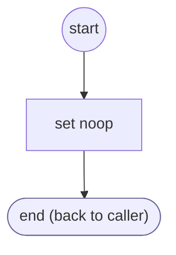

# AddressCityPrompt

<!-- generated:start -->
**AddressCityPrompt** · `address-city-prompt` · version 1.0.0 · worker (called by other flows) · steps · isolated scope

> Ask which of the ZIP code's place names the address carries.

- **Parameters:** 
  - `form`: form
- **Calls:** no other flow
- **Tools:** none
- **Called by:** [collect-geocoded-address](collect-geocoded-address.md) (prepare)

### Steps

<!-- generated:end -->
