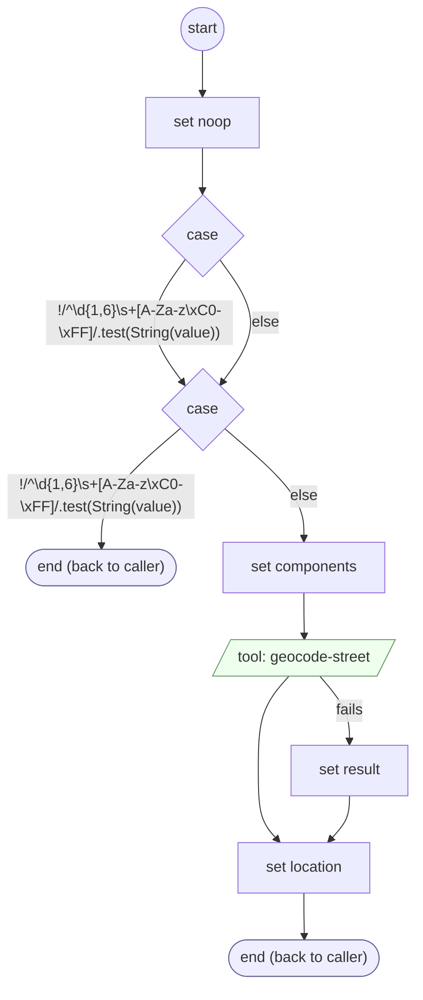

# AddressStreetValidate

<!-- generated:start -->
**AddressStreetValidate** · `address-street-validate` · version 1.0.0 · worker (called by other flows) · steps · isolated scope

> Validate a proposed street against its ZIP; retain unverified wording when geocoding is inconclusive.

- **Parameters:** 
  - `form`: form
  - `value`: value
  - `values`: values
- **Calls:** no other flow
- **Tools:** `geocode-street`
- **Called by:** [collect-geocoded-address](collect-geocoded-address.md) (validator)

### Steps

<!-- generated:end -->
