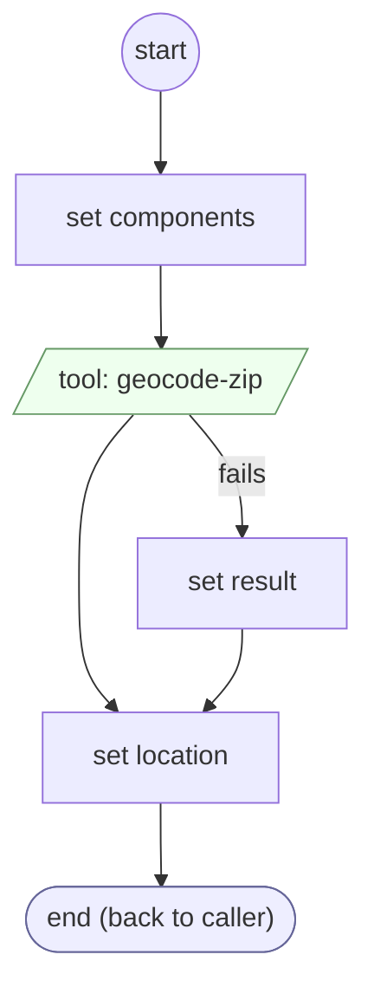

# AddressZipValidate

<!-- generated:start -->
**AddressZipValidate** · `address-zip-validate` · version 1.0.0 · worker (called by other flows) · steps · isolated scope

> Read city and state from geocoder evidence for the proposed ZIP; missing geocoder data requires an explicit city.

- **Parameters:** 
  - `form`: form
  - `value`: value
- **Calls:** no other flow
- **Tools:** `geocode-zip`
- **Called by:** [collect-geocoded-address](collect-geocoded-address.md) (validator)

### Steps

<!-- generated:end -->
