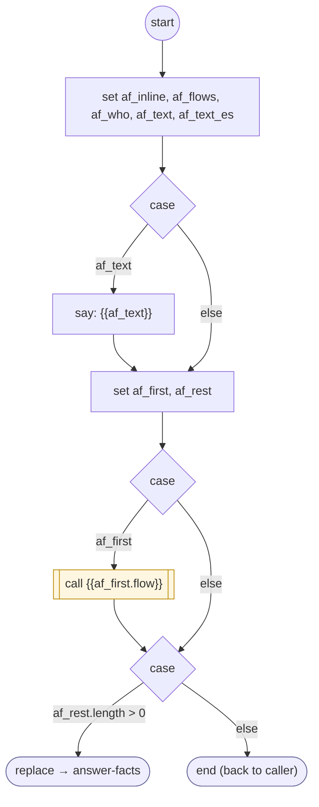

# AnswerFacts

<!-- generated:start -->
**AnswerFacts** · `answer-facts` · version 1.0.0 · worker (called by other flows) · steps · isolated scope

> Worker: say the facts `keys` of a provider catalog in one message, each from its path in the source result through its sentence template (say / say_es: {field} formatted by `format`, {name}, [optional part], [first|second]; a list: format { type: 'list', item, join }, {count}, {items}), per language and channel. A missing value says `missing` (never invented). A fact with its own `flow` is answered by that flow. Params: provides, keys.

- **Parameters:** 
  - `provides`: The provider catalog
  - `keys`: Fact keys to say
- **Calls:** {{af_first.flow}} (call), [answer-facts](answer-facts.md) (replace)
- **Tools:** none
- **Called by:** [provide-data](provide-data.md), [answer-facts](answer-facts.md), [provider-menu](provider-menu.md)

### Steps

<!-- generated:end -->
