# AskAddress

<!-- generated:start -->
**AskAddress** · `ask-address` · version 1.3.1 · worker (called by other flows) · steps · isolated scope

> Worker: a new mailing address (zip, street, unit; Google-checked; read back for YES / NO). The address is step data (owner decision 2026-10-16): what the caller already said — the `given` text (a full or partial address), or any answer holding more than was asked (a whole address typed at the zip question) — fills cargo.addressDraft { zip, said, unit }, and each question is asked only while its field is missing; the draft is kept until the address is confirmed, so a request resumed later asks only what is still missing. Sets cargo.address = { line, street, said, verified } or null.

- **Parameters:** 
  - `attempt`: Internal: the attempt number
  - `given`: An address the caller already gave (full or partial: street, city, state, zip)
- **Calls:** [ask-choice](ask-choice.md) (call), [ask-address](ask-address.md) (replace)
- **Tools:** `geocode-zip`, `geocode-street`
- **Called by:** [ask-address](ask-address.md)

### Steps

```mermaid
flowchart TD
   START(("start"))
   n0["set ad_n, assignment_side_effect, ad_next, ad_q, ad_q_es"]
   START --> n0
   c1{"case"}
   n0 --> c1
   b2[["call ask-choice ad_q"]]
   class b2 flowstep
   c1 -- "!cargo.addressDraft.zip" --> b2
   b3["set assignment_side_effect"]
   c1 -- "else" --> b3
   n4["set ad_zip"]
   b2 --> n4
   b3 --> n4
   c5{"case"}
   n4 --> c5
   b6(["replace → ask-address"])
   class b6 endstep
   c5 -- "!ad_zip && ad_n #lt; 1" --> b6
   c7{"case"}
   c5 -- "else" --> c7
   b8(["end (back to caller)"])
   class b8 endstep
   c7 -- "!ad_zip" --> b8
   n9["set ad_components"]
   c7 -- "else" --> n9
   n10[/"tool: geocode-zip"/]
   class n10 toolstep
   n9 --> n10
   n10f["set ad_zip_result"]
   n10 -- "fails" --> n10f
   n11["set ad_place"]
   n10 --> n11
   n10f --> n11
   c12{"case"}
   n11 --> c12
   b13[["call ask-choice What city and state is that in?"]]
   class b13 flowstep
   c12 -- "!ad_place" --> b13
   n14["set ad_place, ad_q, ad_q_es"]
   b13 --> n14
   c12 -- "else" --> n14
   c15{"case"}
   n14 --> c15
   b16[["call ask-choice ad_q"]]
   class b16 flowstep
   c15 -- "!cargo.addressDraft.said" --> b16
   b17["set assignment_side_effect"]
   c15 -- "else" --> b17
   n18["set ad_said, assignment_side_effect"]
   b16 --> n18
   b17 --> n18
   c19{"case"}
   n18 --> c19
   b20[["call ask-choice Please include the house number and the street na…"]]
   class b20 flowstep
   c19 -- "!/^\d#123;1,6#125;\s.*[A-Za-zÁÉÍÓÚÜÑáéíóúüñ]#123;2,#125;/.test(ad_said)" --> b20
   n21["set ad_said"]
   b20 --> n21
   c19 -- "else" --> n21
   c22{"case"}
   n21 --> c22
   b23(["end (back to caller)"])
   class b23 endstep
   c22 -- "!/^\d#123;1,6#125;\s.*[A-Za-zÁÉÍÓÚÜÑáéíóúüñ]#123;2,#125;/.test(ad_said)" --> b23
   n24[/"tool: geocode-street"/]
   class n24 toolstep
   c22 -- "else" --> n24
   n24f["set ad_street_result"]
   n24 -- "fails" --> n24f
   n25["set ad_norm, ad_verified, ad_street, ad_q, ad_q_es"]
   n24 --> n25
   n24f --> n25
   c26{"case"}
   n25 --> c26
   b27[["call ask-choice ad_q"]]
   class b27 flowstep
   c26 -- "!cargo.addressDraft.unit" --> b27
   b28["set assignment_side_effect"]
   c26 -- "else" --> b28
   n29["set ad_unit, ad_line, ad_q, ad_q_es"]
   b27 --> n29
   b28 --> n29
   n30[["call ask-choice ad_q"]]
   class n30 flowstep
   n29 --> n30
   n31["set assignment_side_effect"]
   n30 --> n31
   c32{"case"}
   n31 --> c32
   b33["set assignment_side_effect"]
   c32 -- "cargo.choice === 'yes'" --> b33
   b34(["replace → ask-address"])
   class b34 endstep
   c32 -- "ad_n #lt; 1" --> b34
   DONE(["end (back to caller)"])
   class DONE endstep
   b33 --> DONE
   c32 -- "else" --> DONE
   classDef endstep fill:#eef,stroke:#669
   classDef toolstep fill:#efe,stroke:#696
   classDef flowstep fill:#fef6e0,stroke:#b80
   classDef inputstep fill:#f3eefc,stroke:#75a
```

<!-- generated:end -->
