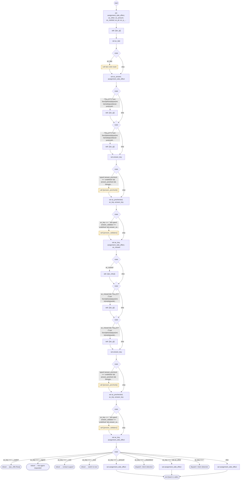

# AskChoice

<!-- generated:start -->
**AskChoice** · `ask-choice` · version 1.19.0 · worker (called by other flows) · steps · isolated scope

> Worker: ask one question and return cargo.choice plus the original cargo.choiceText. Declared choices, precheck keys and typed answer-validator keys keep priority across both read passes. Exact negative choices accept only their own declared words and keys. With amount, an unowned legacy payment question accepts a complete USD monetary answer or a simple payment instruction through readMoneyAmount; uncertain prose yields to DISPATCH without declaring an action failure. A lone digit keeps the question's keypad policy; amount:'marked' still requires marked money. An owning FORM supplies form_context and performs its own field, correction, provider-question and confirmation matching before deciding to retry or yield, retaining its draft and safety guards. Optional answer_precheck runs before choices; answer_validator runs only when no choice matched. AGENT/0 requests a person; EXIT/* leaves the request; a consumed switch offer routes its declared flow. Params include question(_es), choices [{key,phrases,exact?,negative?,neutral?}], retry(_es), accept_other, expect, amount, digits, exit_context(_es), pii and form_context.

- **Parameters:** 
  - `form_context`: Optional declared FORM reader context {form,current,names,questions}; valid field readings take precedence over stale verification-code echoes.
  - `question`: The question (English)
  - `question_es`: The question (Spanish)
  - `choices`: [{key, phrases}] in priority order
  - `retry`: Re-ask wording (English); default "Sorry, I didn't catch that." + the question
  - `retry_es`: Re-ask wording (Spanish)
  - `accept_other`: Return any other answer as choice "other" instead of re-asking
  - `digits`: Keypad input bounds {min, max} on voice
  - `exit_context`: What EXIT abandons, for the support message (English)
  - `exit_context_es`: What EXIT abandons (Spanish)
  - `expect`: With accept_other: what the answer should be — 'number', 'email' or 'contact' (either). Three or more words of neither shape are another request and are DISPATCHed
  - `amount`: true on a payment question: the answer is kept as spoken (the question's asSpoken) and an answer that names an amount ($1, 1 dollar, 12.50) returns cargo.choice = 'amount' with the text — never a keypad key, never a DISPATCH
  - `pii`: true when the answer is sensitive (a card's security code): every question here is a SAY-GET `pii` (jsfe >= 1.3.5), so the host keeps the answer out of its logs and records
  - `answer_validator`: Optional flow name. When an answer picks no choice, it is called (call) with { answer } and MAY set answer_key to a choice key, which is then returned as cargo.choice; if it sets none, the answer is handled as before (amount check, re-ask). Fail-closed. The validator must end by completion: a RETURN in it terminates the conversation turn.
  - `answer_precheck`: Optional flow run with { answer } before the choices are matched; an answer_key it sets is the answer's key (for an answer that must not be read as a choice, such as a question)
  - `reask_long`: true: an answer of three words or more that matches no choice is asked again once (the retry question) instead of being DISPATCHed at once; the second miss is DISPATCHed. For a question whose loss costs the caller real work, e.g. the charge confirmation after a card was typed (owner 2026-10-17).
  - `as_spoken`: Keep exact speech independently of numeric or amount semantics
- **Calls:** [late-code-reask](late-code-reask.md) (call), {{answer_precheck}} (call), {{answer_validator}} (call), {{ac_offer.flow}} (reboot), [live-agent-requested](live-agent-requested.md) (reboot), [contact-support](contact-support.md) (reboot), [switch-to-text](switch-to-text.md) (reboot)
- **Tools:** none
- **Called by:** [ask-address](ask-address.md), [ask-field](ask-field.md), [card-entry](card-entry.md), [collect-input](collect-input.md), [disambiguate-input](disambiguate-input.md), [provide-data](provide-data.md), [confirm-form](confirm-form.md), [provider-menu](provider-menu.md), [collect-geocoded-address-declined](collect-geocoded-address-declined.md)

### Steps

<!-- generated:end -->
