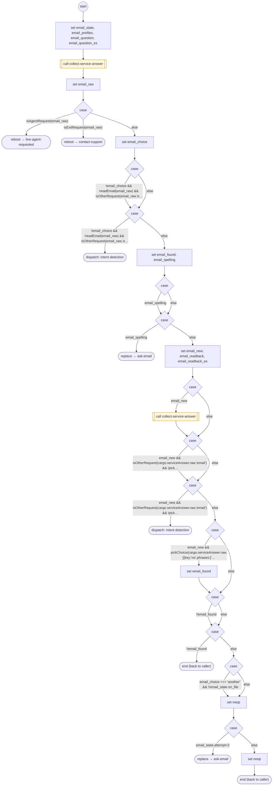

# AskEmail

<!-- generated:start -->
**AskEmail** · `ask-email` · version 1.0.0 · worker (called by other flows) · steps · isolated scope

> Collect an email through shared FORM matching, retaining field-specific spelling and readback behavior.

- **Parameters:** 
  - `question`: English email question
  - `question_es`: Spanish email question
  - `on_file`: Known email offered by OK
  - `attempt`: Retry attempt
  - `why`: invalid, retry or more
  - `confirm`: Read back a caller-supplied known address
  - `parent_form`: Owning task FORM instance
  - `email_state`: Internal field protocol state
- **Calls:** [collect-service-answer](collect-service-answer.md) (call), [live-agent-requested](live-agent-requested.md) (reboot), [contact-support](contact-support.md) (reboot), [ask-email](ask-email.md) (replace)
- **Tools:** none
- **Called by:** [ask-email](ask-email.md)

### Steps

<!-- generated:end -->
