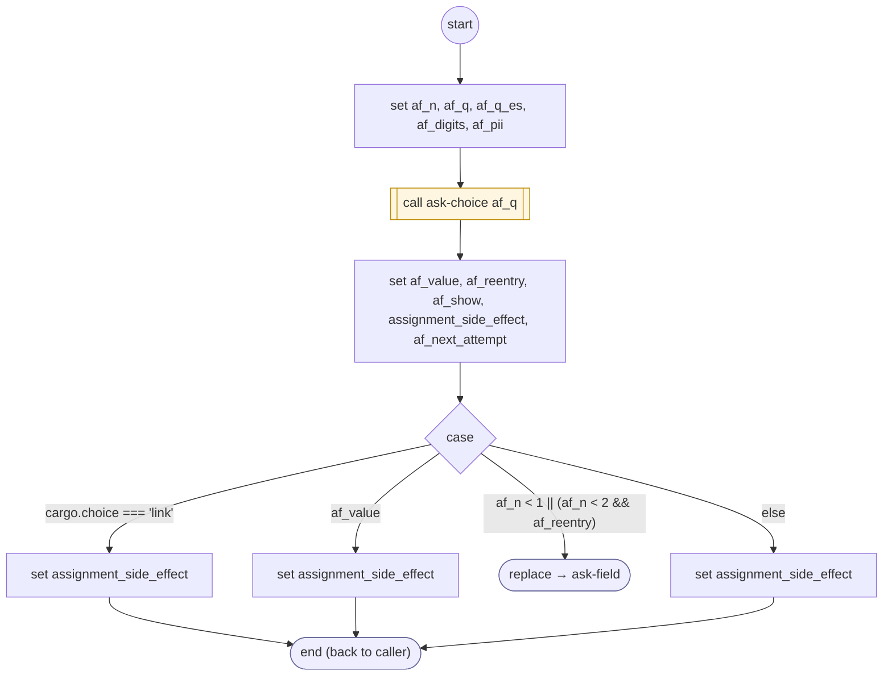

# AskField

<!-- generated:start -->
**AskField** · `ask-field` · version 1.4.0 · worker (called by other flows) · steps · isolated scope

> Worker: one card field, kind 'card' | 'exp' | 'cvv' | 'zip'. Sets cargo.field and cargo.fieldOutcome ('ok' | 'link' | 'failed'); the answer is erased from cargo.choiceText once read. Two tries; the card number gets a third when its second answer was another card entry (12 or more digits). On voice the card number's keypad completes by shape (digits.complete, by first digit). An answer with no digits ("tarjeta nueva" said again) is asked again without the error line.

- **Parameters:** 
  - `kind`: 'card' | 'exp' | 'cvv' | 'zip'
  - `question`: The question (English)
  - `question_es`: The question (Spanish)
  - `error`: Said before the re-ask (English)
  - `error_es`: Said before the re-ask (Spanish)
  - `attempt`: Internal: the attempt number
  - `show_error`: 'no': the previous answer had no digits (words such as "tarjeta nueva"), so the question is asked again without the error line. Absent: the error is shown, as before.
- **Calls:** [ask-choice](ask-choice.md) (call), [ask-field](ask-field.md) (replace)
- **Tools:** none
- **Called by:** [ask-field](ask-field.md), [card-entry](card-entry.md)

### Steps

<!-- generated:end -->
