# AuthenticateUser

<!-- generated:start -->
**AuthenticateUser** · `authenticate-user` · version 1.0.0 · worker (called by other flows) · steps · shared scope

> Authenticate a contact using shared FORM collection and one-time-code services.

- **Parameters:** 
  - `retry_flow`: retry flow
  - `cancel_flow`: cancel flow
  - `cell_number`: cell number
  - `email`: email
  - `email_validator`: email validator
  - `cell_validator`: cell validator
  - `code_validator`: code validator
  - `answer_handler`: answer handler
  - `retry_returns`: retry returns
  - `retrying`: retrying
  - `declined_caller`: declined caller
  - `parent_form`: parent form
  - `task`: task
  - `task_es`: task es
  - `failed_flow`: failed flow
  - `caller_on_file`: Caller-ID eligibility inherited from the invoking service
- **Calls:** [contact-support](contact-support.md) (by name), [task-gate](task-gate.md) (call), [authenticate-user](authenticate-user.md) (gate of task-gate, retry_flow of generic-retry-with-options), [get-cell-or-email](get-cell-or-email.md) (call), {{cell_validator}} (call), {{email_validator}} (call), [generic-retry-with-options](generic-retry-with-options.md) (replace), [get-and-validate-otp-code](get-and-validate-otp-code.md) (call), [send-otp-code](send-otp-code.md) (call), [otp-send-failed](otp-send-failed.md) (replace)
- **Tools:** none
- **Called by:** [authenticate-user](authenticate-user.md) (gate of task-gate, retry_flow of generic-retry-with-options), [get-cell-or-email](get-cell-or-email.md) (value, by name), [validate-otp-code](validate-otp-code.md) (retry_flow of generic-retry-with-options, retry_flow, by name), [generic-retry-with-options](generic-retry-with-options.md) (value), [otp-send-failed](otp-send-failed.md) (retry_flow of generic-retry-with-options, retry_flow), [otp-text-undeliverable](otp-text-undeliverable.md), [shopify-ql-track-order](../shopify/shopify-ql-track-order.md) (shopify), [shopify-ql-order-gate](../shopify/shopify-ql-order-gate.md) (shopify)

### Steps

```mermaid
flowchart TD
   START(("start"))
   n0["set auth_retry_code_message, auth_retry_code_message_es, otp_no_phone_mes…"]
   START --> n0
   c1{"case"}
   n0 --> c1
   c2{"case"}
   c1 -- "declined_caller === true #124;#124; declined_caller === 'true'" --> c2
   c1 -- "else" --> c2
   b3(["end (back to caller)"])
   class b3 endstep
   c2 -- "cargo.otpVerified === true" --> b3
   n4["set retry_flow, cancel_flow, email_validator, cell_validator, code_valida…"]
   c2 -- "else" --> n4
   c5{"case"}
   n4 --> c5
   b6(["end (back to caller)"])
   class b6 endstep
   c5 -- "cargo.authRetry" --> b6
   n7[["call task-gate"]]
   class n7 flowstep
   c5 -- "else" --> n7
   n8[["call get-cell-or-email"]]
   class n8 flowstep
   n7 --> n8
   n9["set contact_valid"]
   n8 --> n9
   c10{"case"}
   n9 --> c10
   b11[["call #123;#123;cell_validator#125;#125;"]]
   class b11 flowstep
   c10 -- "cell_number && cell_validator" --> b11
   b12[["call #123;#123;email_validator#125;#125;"]]
   class b12 flowstep
   c10 -- "email && email_validator" --> b12
   n13["set auth_contact_error, auth_contact_error_es"]
   b11 --> n13
   b12 --> n13
   c10 -- "else" --> n13
   c14{"case"}
   n13 --> c14
   b15(["replace → generic-retry-with-options"])
   class b15 endstep
   c14 -- "contact_valid !== true" --> b15
   n16["set auth_join"]
   c14 -- "else" --> n16
   c17{"case"}
   n16 --> c17
   c18{"case"}
   c17 -- "auth_join" --> c18
   c17 -- "else" --> c18
   b19[["call get-and-validate-otp-code"]]
   class b19 flowstep
   c18 -- "auth_join" --> b19
   c20{"case"}
   b19 --> c20
   c18 -- "else" --> c20
   b21[["call task-gate"]]
   class b21 flowstep
   c20 -- "auth_join" --> b21
   c22{"case"}
   b21 --> c22
   c20 -- "else" --> c22
   b23(["end (back to caller)"])
   class b23 endstep
   c22 -- "auth_join" --> b23
   n24["set noop"]
   c22 -- "else" --> n24
   n25[["call send-otp-code"]]
   class n25 flowstep
   n24 --> n25
   c26{"case"}
   n25 --> c26
   b27(["replace → otp-send-failed"])
   class b27 endstep
   c26 -- "cargo.otpSendFailure" --> b27
   n28[["call get-and-validate-otp-code"]]
   class n28 flowstep
   c26 -- "else" --> n28
   c29{"case"}
   n28 --> c29
   b30["set auth_result"]
   c29 -- "cargo.otpVerified === true" --> b30
   b31(["end (back to caller)"])
   class b31 endstep
   c29 -- "cargo.authRetry" --> b31
   b32(["replace → generic-retry-with-options"])
   class b32 endstep
   c29 -- "else" --> b32
   n33[["call task-gate"]]
   class n33 flowstep
   b30 --> n33
   DONE(["end (back to caller)"])
   class DONE endstep
   n33 --> DONE
   classDef endstep fill:#eef,stroke:#669
   classDef toolstep fill:#efe,stroke:#696
   classDef flowstep fill:#fef6e0,stroke:#b80
   classDef inputstep fill:#f3eefc,stroke:#75a
```

<!-- generated:end -->
