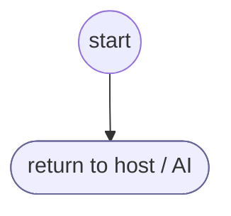

# CancelProcess

<!-- generated:start -->
**CancelProcess** · `cancel-process` · version 1.0.0 · worker (called by other flows) · steps

> Handle flow cancellation by user

- **Parameters:** none
- **Calls:** no other flow
- **Tools:** none
- **Called by:** nothing (unreachable)

### Steps

<!-- generated:end -->
