# CardEntry

<!-- generated:start -->
**CardEntry** · `card-entry` · version 1.4.0 · worker (called by other flows) · steps · isolated scope

> Worker: a new card's number, expiration, security code and billing zip (each through ask-field), and whether to save it. Every field the caller gives is kept in cargo.cardDraft and asked only while it is missing, so a card half entered is resumed, never asked again (owner decision 2026-10-16: payment input is never lost). A complete card is PENDING: first in cargo.pendingCards { kind: 'card', card, save, last4, label, label_es, pending: true }, kept for the session (never erased; the session's expiry ends it), and the payment uses it without asking which card. Sets cargo.payMethod to it, or cargo.payNext 'link' / 'card_failed'. The save question is skipped when the caller already said (cargo.saveCardPick 'yes'/'no'), and an answer is kept there.

- **Parameters:** none
- **Calls:** [ask-field](ask-field.md) (call), [ask-choice](ask-choice.md) (call)
- **Tools:** none
- **Called by:** nothing (unreachable)

### Steps

```mermaid
flowchart TD
   START(("start"))
   n0["set assignment_side_effect, ce_q, ce_q_es"]
   START --> n0
   c1{"case"}
   n0 --> c1
   b2[["call ask-field"]]
   class b2 flowstep
   c1 -- "!cargo.cardDraft.number" --> b2
   b3["set assignment_side_effect"]
   c1 -- "else" --> b3
   c4{"case"}
   b2 --> c4
   b3 --> c4
   b5["set assignment_side_effect"]
   c4 -- "cargo.fieldOutcome !== 'ok'" --> b5
   c6{"case"}
   b5 --> c6
   c4 -- "else" --> c6
   b7(["end (back to caller)"])
   class b7 endstep
   c6 -- "cargo.fieldOutcome !== 'ok'" --> b7
   n8["set ce_number_value, ce_q, ce_q_es"]
   c6 -- "else" --> n8
   c9{"case"}
   n8 --> c9
   b10[["call ask-field"]]
   class b10 flowstep
   c9 -- "!cargo.cardDraft.exp" --> b10
   b11["set assignment_side_effect"]
   c9 -- "else" --> b11
   c12{"case"}
   b10 --> c12
   b11 --> c12
   b13["set assignment_side_effect"]
   c12 -- "cargo.fieldOutcome !== 'ok'" --> b13
   c14{"case"}
   b13 --> c14
   c12 -- "else" --> c14
   b15(["end (back to caller)"])
   class b15 endstep
   c14 -- "cargo.fieldOutcome !== 'ok'" --> b15
   n16["set ce_exp_value, ce_q, ce_q_es"]
   c14 -- "else" --> n16
   c17{"case"}
   n16 --> c17
   b18[["call ask-field"]]
   class b18 flowstep
   c17 -- "!cargo.cardDraft.cvv" --> b18
   b19["set assignment_side_effect"]
   c17 -- "else" --> b19
   c20{"case"}
   b18 --> c20
   b19 --> c20
   b21["set assignment_side_effect"]
   c20 -- "cargo.fieldOutcome !== 'ok'" --> b21
   c22{"case"}
   b21 --> c22
   c20 -- "else" --> c22
   b23(["end (back to caller)"])
   class b23 endstep
   c22 -- "cargo.fieldOutcome !== 'ok'" --> b23
   n24["set ce_cvv_value, ce_q, ce_q_es"]
   c22 -- "else" --> n24
   c25{"case"}
   n24 --> c25
   b26[["call ask-field"]]
   class b26 flowstep
   c25 -- "!cargo.cardDraft.zip" --> b26
   b27["set assignment_side_effect"]
   c25 -- "else" --> b27
   c28{"case"}
   b26 --> c28
   b27 --> c28
   b29["set assignment_side_effect"]
   c28 -- "cargo.fieldOutcome !== 'ok'" --> b29
   c30{"case"}
   b29 --> c30
   c28 -- "else" --> c30
   b31(["end (back to caller)"])
   class b31 endstep
   c30 -- "cargo.fieldOutcome !== 'ok'" --> b31
   n32["set ce_zip_value, assignment_side_effect, ce_q, ce_q_es"]
   c30 -- "else" --> n32
   c33{"case"}
   n32 --> c33
   b34["set assignment_side_effect"]
   c33 -- "cargo.saveCardPick === 'yes' #124;#124; cargo.saveCardPick === 'no'" --> b34
   b35[["call ask-choice ce_q"]]
   class b35 flowstep
   c33 -- "else" --> b35
   n36["set assignment_side_effect"]
   b34 --> n36
   b35 --> n36
   DONE(["end (back to caller)"])
   class DONE endstep
   n36 --> DONE
   classDef endstep fill:#eef,stroke:#669
   classDef toolstep fill:#efe,stroke:#696
   classDef flowstep fill:#fef6e0,stroke:#b80
   classDef inputstep fill:#f3eefc,stroke:#75a
```

<!-- generated:end -->
