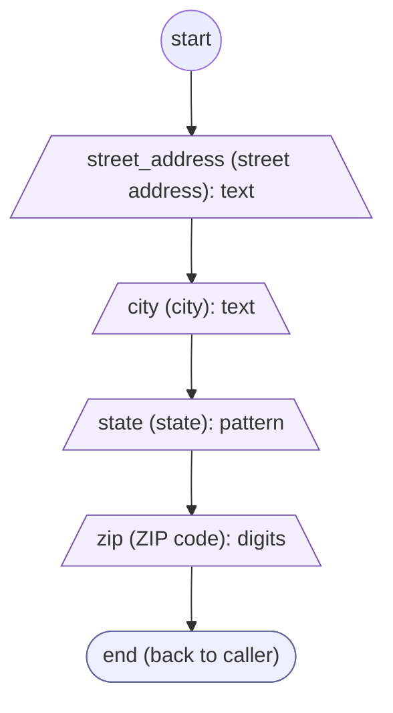
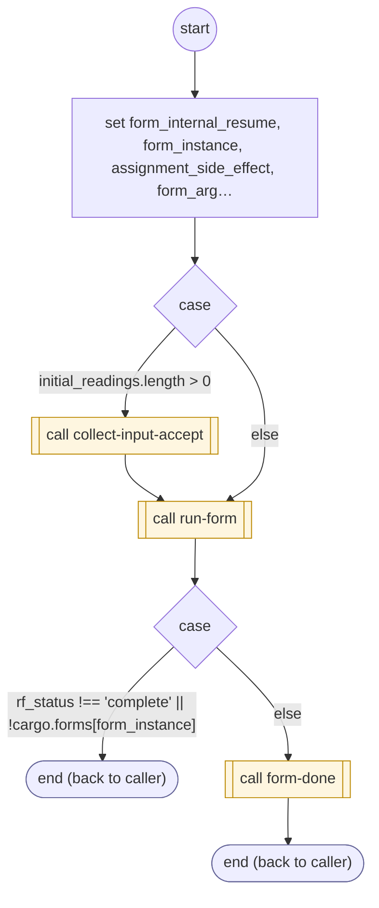

# CollectAddress

<!-- generated:start -->
**CollectAddress** · `collect-address` · version 1.0.0 · worker (called by other flows) · form + steps · isolated scope

> Sub-form: street address, city, state, ZIP, in any order. Result: the parent's result input (or cargo.formResults['collect-address']).

- **Parameters:** 
  - `form_instance`: Internal instance to resume
- **Calls:** [collect-input-accept](collect-input-accept.md) (call), [run-form](run-form.md) (call), [form-done](form-done.md) (call)
- **Tools:** none
- **Called by:** nothing (unreachable)

### Form inputs

### Steps

<!-- generated:end -->
