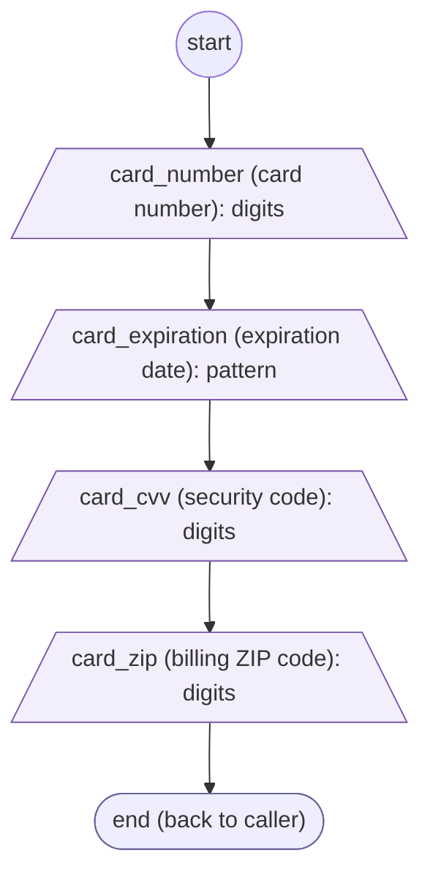
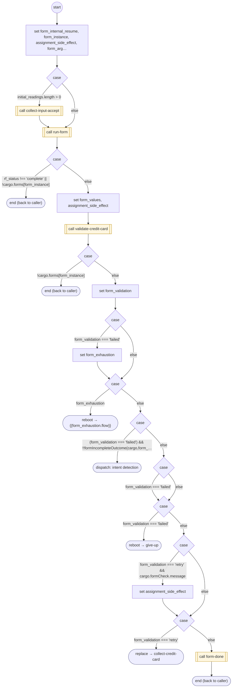

# CollectCreditCard

<!-- generated:start -->
**CollectCreditCard** · `collect-credit-card` · version 1.0.0 · worker (called by other flows) · form + steps · isolated scope

> Sub-form: card number, expiration, security code, billing ZIP, in any order. Result (with keep_pii for the charge step): the parent's result input.

- **Parameters:** 
  - `form_instance`: Internal instance to resume
- **Calls:** [validate-card-number](validate-card-number.md) (validator), [validate-card-expiration](validate-card-expiration.md) (validator), [validate-card-cvv](validate-card-cvv.md) (validator), [collect-input-accept](collect-input-accept.md) (call), [run-form](run-form.md) (call), [validate-credit-card](validate-credit-card.md) (call), {{form_exhaustion.flow}} (reboot), [give-up](give-up.md) (reboot), [collect-credit-card](collect-credit-card.md) (replace), [form-done](form-done.md) (call)
- **Tools:** none
- **Called by:** [collect-credit-card](collect-credit-card.md)

### Form inputs

### Steps

<!-- generated:end -->
