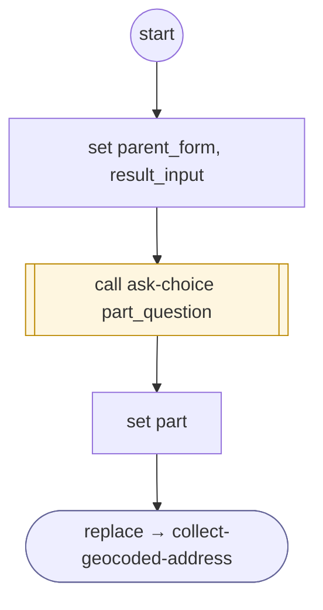

# CollectGeocodedAddressDeclined

<!-- generated:start -->
**CollectGeocodedAddressDeclined** · `collect-geocoded-address-declined` · version 1.0.0 · worker (called by other flows) · steps · isolated scope

> Ask which part of the declined address is wrong, re-ask only that part, or start a fresh pass.

- **Parameters:** 
  - `form_instance`: form_instance
- **Calls:** [ask-choice](ask-choice.md) (call), [collect-geocoded-address](collect-geocoded-address.md) (replace)
- **Tools:** none
- **Called by:** [collect-geocoded-address](collect-geocoded-address.md)

### Steps

<!-- generated:end -->
