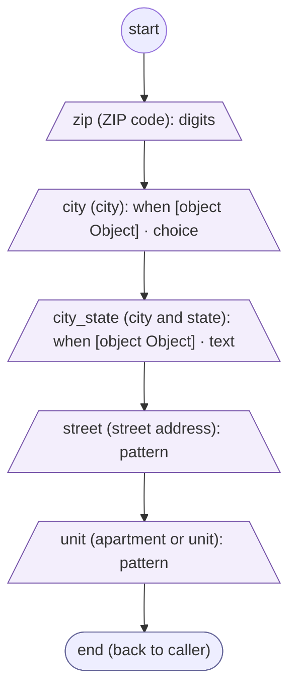
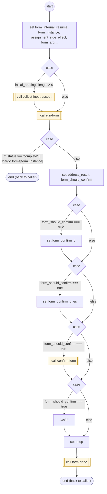

# CollectGeocodedAddress

<!-- generated:start -->
**CollectGeocodedAddress** · `collect-geocoded-address` · version 1.0.0 · worker (called by other flows) · form + steps · isolated scope

> Collect a mailing address in any order, project geocoder evidence, and read the complete address back for confirmation.

- **Parameters:** 
  - `given`: given
  - `form_instance`: Internal instance to resume
- **Calls:** [address-zip-prompt](address-zip-prompt.md) (prepare), [address-zip-validate](address-zip-validate.md) (validator), [address-city-prompt](address-city-prompt.md) (prepare), [address-street-prompt](address-street-prompt.md) (prepare), [address-street-validate](address-street-validate.md) (validator), [collect-input-accept](collect-input-accept.md) (call), [run-form](run-form.md) (call), [confirm-form](confirm-form.md) (call), [collect-geocoded-address](collect-geocoded-address.md) (replace), [collect-geocoded-address-declined](collect-geocoded-address-declined.md) (replace), [form-done](form-done.md) (call)
- **Tools:** none
- **Called by:** [collect-geocoded-address](collect-geocoded-address.md), [collect-geocoded-address-declined](collect-geocoded-address-declined.md)

### Form inputs

### Steps

<!-- generated:end -->
