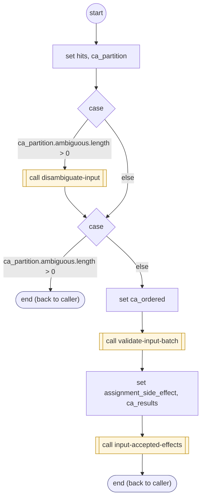

# CollectInputAccept

<!-- generated:start -->
**CollectInputAccept** · `collect-input-accept` · version 2.0.0 · worker (called by other flows) · steps · isolated scope

> Worker: validate all readings, commit accepted changes once with transitive invalidation, then acknowledge and run declared callbacks.

- **Parameters:** 
  - `hits`: 
- **Calls:** [disambiguate-input](disambiguate-input.md) (call), [validate-input-batch](validate-input-batch.md) (call), [input-accepted-effects](input-accepted-effects.md) (call)
- **Tools:** none
- **Called by:** [run-form](run-form.md), [collect-input](collect-input.md), [disambiguate-input](disambiguate-input.md), [collect-phone](collect-phone.md), [collect-email](collect-email.md), [collect-zip](collect-zip.md), [collect-street-address](collect-street-address.md), [collect-city](collect-city.md), [collect-card-number](collect-card-number.md), [collect-card-expiration](collect-card-expiration.md), [collect-card-cvv](collect-card-cvv.md), [collect-card-zip](collect-card-zip.md), [collect-address](collect-address.md), [collect-credit-card](collect-credit-card.md), [confirm-form](confirm-form.md), [collect-service-answer](collect-service-answer.md), [collect-geocoded-address](collect-geocoded-address.md), [confirm-input-proposal](confirm-input-proposal.md), [collect-contextual-answer](collect-contextual-answer.md), [read-form-choice](read-form-choice.md), [read-confirm-reply](read-confirm-reply.md), [shopify-ql-get-search-query](../shopify/shopify-ql-get-search-query.md) (shopify), [shopify-ql-product-dialog](../shopify/shopify-ql-product-dialog.md) (shopify), [shopify-ql-product-stores](../shopify/shopify-ql-product-stores.md) (shopify), [shopify-ql-product-variant](../shopify/shopify-ql-product-variant.md) (shopify), [shopify-ql-product-location-retry](../shopify/shopify-ql-product-location-retry.md) (shopify), [shopify-ql-product-links](../shopify/shopify-ql-product-links.md) (shopify), [shopify-ql-order-question](../shopify/shopify-ql-order-question.md) (shopify), [shopify-ql-tracking-inputs](../shopify/shopify-ql-tracking-inputs.md) (shopify), [shopify-ql-policy-question](../shopify/shopify-ql-policy-question.md) (shopify)

### Steps

<!-- generated:end -->
