# CollectInput

<!-- generated:start -->
**CollectInput** · `collect-input` · version 1.0.0 · worker (called by other flows) · steps · isolated scope

> Worker: ask the form's current input once and file the answer wherever it belongs in the form chain (matchInputs, decided by scope; a declared confirm_against pair is asked). One reading → collect-input-accept; ambiguous → disambiguate-input; a question about the form's data → provide-data; a short miss → counted, the loop re-asks; 3+ words that fit nothing → DISPATCH. Params: form, current, questions, provides, exit_context(_es).

- **Parameters:** 
  - `form`: form
  - `current`: current
  - `questions`: questions
  - `provides`: provides
  - `exit_context`: exit_context
  - `exit_context_es`: exit_context_es
- **Calls:** {{ci_exhaustion.flow}} (reboot), [give-up](give-up.md) (reboot), [prepare-input](prepare-input.md) (call), {{ci_spec.refresh}} (call), [ask-choice](ask-choice.md) (call), {{ci_routed}} (call), [disambiguate-input](disambiguate-input.md) (call), [collect-input-accept](collect-input-accept.md) (call), [provide-data](provide-data.md) (call), [read-form-choice](read-form-choice.md) (by name), [read-form-reply](read-form-reply.md) (by name), {{ci_reply_reader}} (call)
- **Tools:** none
- **Called by:** [run-form](run-form.md)

### Steps

```mermaid
flowchart TD
   START(("start"))
   n0["set ci_spec, ci_names"]
   START --> n0
   c1{"case"}
   n0 --> c1
   b2(["end (back to caller)"])
   class b2 endstep
   c1 -- "!ci_spec" --> b2
   n3["set ci_missed, ci_max, ci_misses, ci_miss_limit, ci_must"]
   c1 -- "else" --> n3
   c4{"case"}
   n3 --> c4
   b5(["dispatch: intent detection"])
   class b5 endstep
   c4 -- "ci_misses #gt;= ci_miss_limit && !ci_must" --> b5
   n6["set ci_ctx, ci_ctx_es"]
   c4 -- "else" --> n6
   c7{"case"}
   n6 --> c7
   b8["set ci_exhaustion"]
   c7 -- "ci_missed #gt;= ci_max" --> b8
   c9{"case"}
   b8 --> c9
   c7 -- "else" --> c9
   b10(["reboot → #123;#123;ci_exhaustion.flow#125;#125;"])
   class b10 endstep
   c9 -- "ci_exhaustion" --> b10
   c11{"case"}
   c9 -- "else" --> c11
   b12(["dispatch: intent detection"])
   class b12 endstep
   c11 -- "(ci_missed #gt;= ci_max) && !!formIncompleteOutcome(cargo,form,#123;outcome:…" --> b12
   c13{"case"}
   c11 -- "else" --> c13
   c14{"case"}
   c13 -- "ci_missed #gt;= ci_max" --> c14
   c13 -- "else" --> c14
   b15(["reboot → give-up"])
   class b15 endstep
   c14 -- "ci_missed #gt;= ci_max" --> b15
   n16[["call prepare-input"]]
   class n16 flowstep
   c14 -- "else" --> n16
   c17{"case"}
   n16 --> c17
   b18[["call #123;#123;ci_spec.refresh#125;#125;"]]
   class b18 flowstep
   c17 -- "ci_spec.refresh" --> b18
   n19["set ci_spec, ci_d, ci_q, ci_q_es, assignment_side_effect, ci_choices, ci_…"]
   b18 --> n19
   c17 -- "else" --> n19
   n20[["call ask-choice ci_q"]]
   class n20 flowstep
   n19 --> n20
   n21["set assignment_side_effect, ci_routed"]
   n20 --> n21
   c22{"case"}
   n21 --> c22
   b23[["call #123;#123;ci_routed#125;#125;"]]
   class b23 flowstep
   c22 -- "ci_routed" --> b23
   c24{"case"}
   b23 --> c24
   c22 -- "else" --> c24
   b25(["end (back to caller)"])
   class b25 endstep
   c24 -- "ci_routed" --> b25
   n26["set ci_partial"]
   c24 -- "else" --> n26
   c27{"case"}
   n26 --> c27
   b28(["end (back to caller)"])
   class b28 endstep
   c27 -- "ci_partial === 'hold'" --> b28
   n29["set ci_chain, ci_m, assignment_side_effect, ci_qkey"]
   c27 -- "else" --> n29
   c30{"case"}
   n29 --> c30
   b31["set assignment_side_effect"]
   c30 -- "ci_m.hits.length #124;#124; ci_m.ambiguous.length #124;#124; ci_m.questions.length #124;#124;…" --> b31
   n32["set ci_words"]
   b31 --> n32
   c30 -- "else" --> n32
   c33{"case"}
   n32 --> c33
   b34[["call disambiguate-input"]]
   class b34 flowstep
   c33 -- "ci_m.questions.length #gt; 0 && ci_m.ambiguous.length #gt; 0" --> b34
   c35{"case"}
   b34 --> c35
   c33 -- "else" --> c35
   b36[["call collect-input-accept"]]
   class b36 flowstep
   c35 -- "ci_m.questions.length #gt; 0 && !ci_m.ambiguous.length && ci_m.hits.leng…" --> b36
   n37["set ci_skip_gate"]
   b36 --> n37
   c35 -- "else" --> n37
   c38{"case"}
   n37 --> c38
   b39[["call provide-data"]]
   class b39 flowstep
   c38 -- "ci_m.questions.length #gt; 0" --> b39
   c40{"case"}
   b39 --> c40
   c38 -- "else" --> c40
   b41(["end (back to caller)"])
   class b41 endstep
   c40 -- "ci_m.questions.length #gt; 0" --> b41
   n42["set ci_reply_reader"]
   c40 -- "else" --> n42
   c43{"case"}
   n42 --> c43
   b44[["call disambiguate-input"]]
   class b44 flowstep
   c43 -- "ci_m.ambiguous.length #gt; 0" --> b44
   b45[["call collect-input-accept"]]
   class b45 flowstep
   c43 -- "ci_m.hits.length #gt; 0" --> b45
   b46(["end (back to caller)"])
   class b46 endstep
   c43 -- "ci_m.questions.length #gt; 0" --> b46
   b47[["call provide-data"]]
   class b47 flowstep
   c43 -- "ci_qkey && ci_qkey.indexOf('__') !== 0" --> b47
   b48[["call #123;#123;ci_reply_reader#125;#125;"]]
   class b48 flowstep
   c43 -- "!ci_must && ci_words #gt; 0" --> b48
   b49["set assignment_side_effect"]
   c43 -- "else" --> b49
   DONE(["end (back to caller)"])
   class DONE endstep
   b44 --> DONE
   b45 --> DONE
   b47 --> DONE
   b48 --> DONE
   b49 --> DONE
   classDef endstep fill:#eef,stroke:#669
   classDef toolstep fill:#efe,stroke:#696
   classDef flowstep fill:#fef6e0,stroke:#b80
   classDef inputstep fill:#f3eefc,stroke:#75a
```

<!-- generated:end -->
