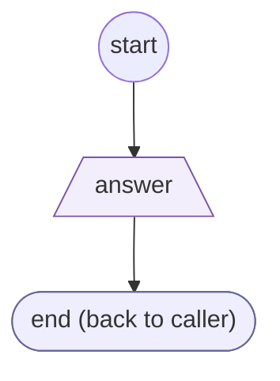
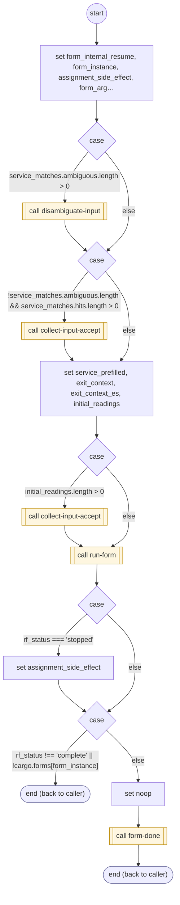

# CollectServiceAnswer

<!-- generated:start -->
**CollectServiceAnswer** · `collect-service-answer` · worker (called by other flows) · form + steps · isolated scope

> Collect one protocol answer against explicit profiles and the owning FORM ancestry; return its accepted readings and original text.

- **Parameters:** 
  - `profiles`: Declared alternative input profiles
  - `question`: English prompt
  - `question_es`: Spanish prompt
  - `keypad`: Keypad completion metadata
  - `prefill`: An activation answer to validate through the same profiles
  - `context`: Exit context
  - `context_es`: Spanish exit context
  - `stop_path`: State path that completes this protocol without another answer
  - `form_instance`: Internal instance to resume
- **Calls:** [service-answer-raw](service-answer-raw.md) (answer_precheck, by name), [disambiguate-input](disambiguate-input.md) (call), [collect-input-accept](collect-input-accept.md) (call), [run-form](run-form.md) (call), [form-done](form-done.md) (call)
- **Tools:** none
- **Called by:** [get-cell-or-email](get-cell-or-email.md), [get-and-validate-otp-code](get-and-validate-otp-code.md), [generic-retry-with-options](generic-retry-with-options.md), [otp-text-undeliverable](otp-text-undeliverable.md), [ask-email](ask-email.md)

### Form inputs

### Steps

<!-- generated:end -->
