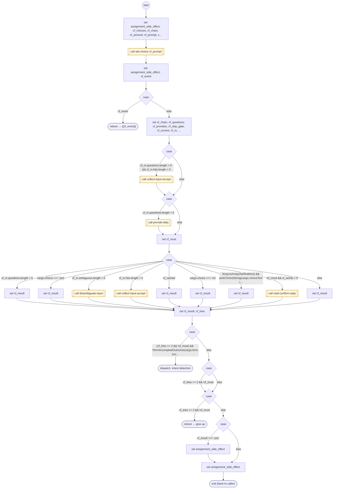

# ConfirmForm

<!-- generated:start -->
**ConfirmForm** · `confirm-form` · version 1.0.0 · worker (called by other flows) · steps · isolated scope

> Worker: ask a form's confirmation (exact YES / NO; keys 1 and 2). A correction instead ('no, make it $40') is read against the form chain and stored, and the result is 'changed' so the form runs again; an answer with words it cannot read goes to the reply ranker (read-confirm-reply); an unclear one is asked again, and after two the give-up worker takes over. Result: cargo.formConfirm[form] = 'yes' | 'no' | 'changed'. Params: form, question(_es), exit_context(_es).

- **Parameters:** 
  - `form`: form
  - `question`: question
  - `question_es`: question_es
  - `exit_context`: exit_context
  - `exit_context_es`: exit_context_es
  - `phrases`: phrases
  - `words`: words
  - `interrupts`: interrupts
  - `no_keys`: no_keys
  - `clarifications`: clarifications
  - `invites`: invites
  - `named_fields`: true: an answer that names one of the form's inputs (its names) without a value re-asks only that input
- **Calls:** [validate-card-number](validate-card-number.md) (validator), [validate-card-expiration](validate-card-expiration.md) (validator), [validate-card-cvv](validate-card-cvv.md) (validator), [ask-choice](ask-choice.md) (call), {{cf_event}} (reboot), [collect-input-accept](collect-input-accept.md) (call), [provide-data](provide-data.md) (call), [disambiguate-input](disambiguate-input.md) (call), [read-confirm-reply](read-confirm-reply.md) (call), [give-up](give-up.md) (reboot)
- **Tools:** none
- **Called by:** [collect-geocoded-address](collect-geocoded-address.md), [confirm-input-proposal](confirm-input-proposal.md)

### Steps

<!-- generated:end -->
