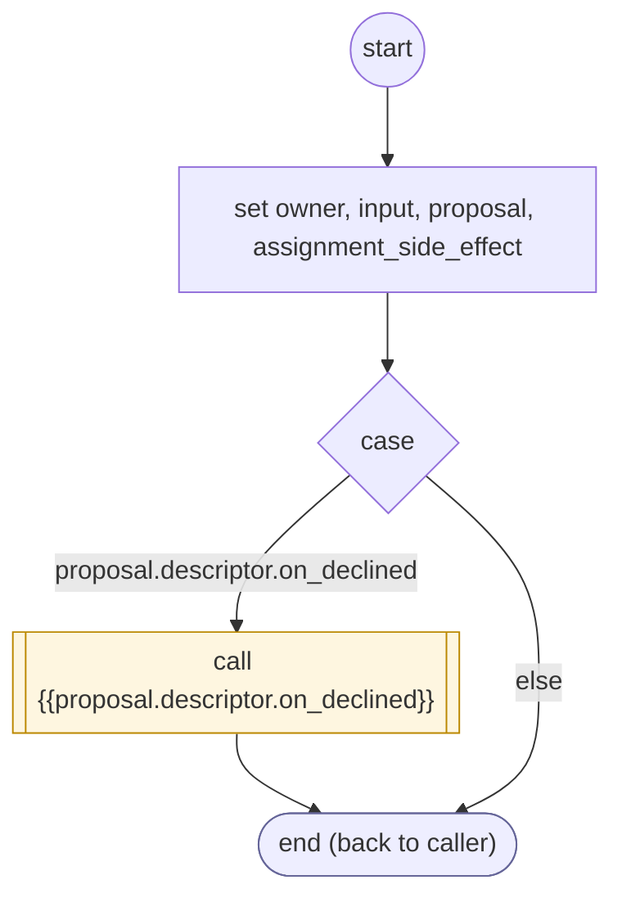

# ConfirmInputProposalDeclined

<!-- generated:start -->
**ConfirmInputProposalDeclined** · `confirm-input-proposal-declined` · version 1.0.0 · worker (called by other flows) · steps · isolated scope

> Reject an owned input proposal without accepting its candidate or handing incomplete data to its parent.

- **Parameters:** 
  - `form_instance`: 
- **Calls:** {{proposal.descriptor.on_declined}} (call)
- **Tools:** none
- **Called by:** [confirm-input-proposal](confirm-input-proposal.md)

### Steps

<!-- generated:end -->
