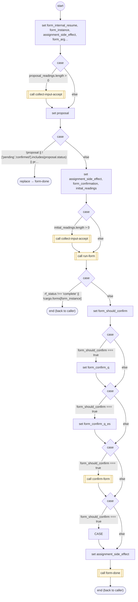

# ConfirmInputProposal

<!-- generated:start -->
**ConfirmInputProposal** · `confirm-input-proposal` · version 1.0.0 · worker (called by other flows) · form + steps · isolated scope

> Confirm an owned validated input candidate; retain it on yield and authorize only normal input acceptance.

- **Parameters:** 
  - `input`: Owning input awaiting proposal confirmation
  - `form_instance`: Internal instance to resume
- **Calls:** [collect-input-accept](collect-input-accept.md) (call), [form-done](form-done.md) (replace, call), [run-form](run-form.md) (call), [confirm-form](confirm-form.md) (call), [confirm-input-proposal](confirm-input-proposal.md) (replace), [confirm-input-proposal-declined](confirm-input-proposal-declined.md) (replace)
- **Tools:** none
- **Called by:** [run-form](run-form.md), [confirm-input-proposal](confirm-input-proposal.md)

### Steps

<!-- generated:end -->
