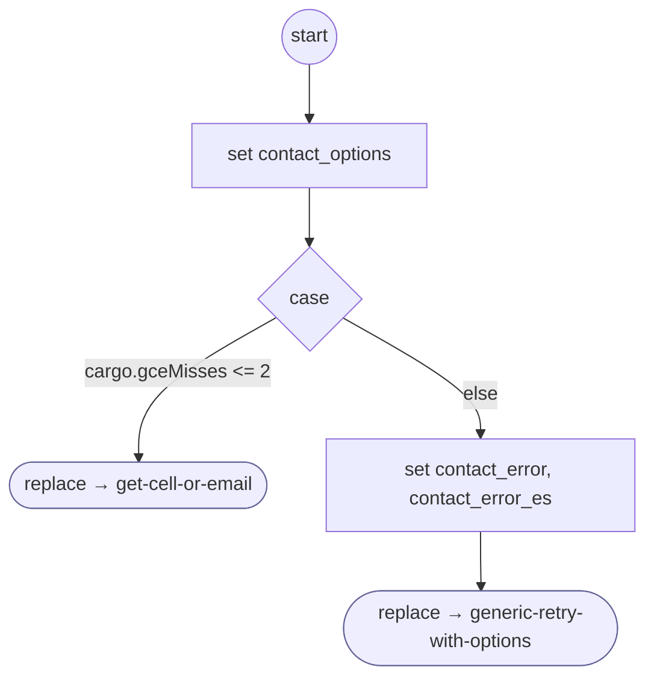

# ContactMisread

<!-- generated:start -->
**ContactMisread** · `contact-misread` · version 1.0.0 · worker (called by other flows) · steps · shared scope

> Ask the contact question again after an answer that is no contact, then offer the common retry menu at the third miss in a row.

- **Parameters:** 
  - `contact_options`: Current contact service options
  - `error_message`: Why the answer was not used
  - `error_message_es`: Spanish: why the answer was not used
- **Calls:** [get-cell-or-email](get-cell-or-email.md) (replace), [generic-retry-with-options](generic-retry-with-options.md) (replace)
- **Tools:** none
- **Called by:** [get-cell-or-email](get-cell-or-email.md)

### Steps

<!-- generated:end -->
