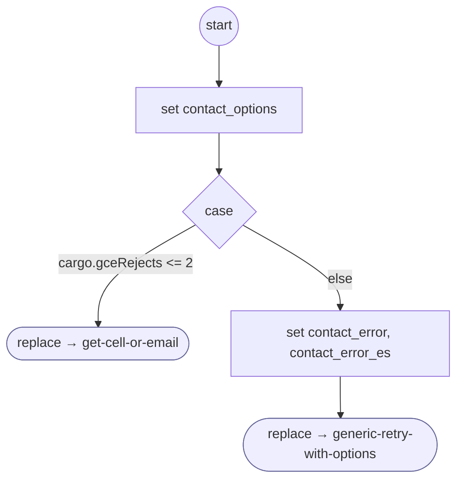

# ContactNotOnFile

<!-- generated:start -->
**ContactNotOnFile** · `contact-not-on-file` · version 1.0.0 · worker (called by other flows) · steps · shared scope

> Re-collect a rejected account contact, then offer the common retry menu at the rejection limit.

- **Parameters:** 
  - `contact_options`: Current contact service options
  - `error_message`: Rejection sentence
  - `error_message_es`: Spanish rejection sentence
- **Calls:** [get-cell-or-email](get-cell-or-email.md) (replace), [generic-retry-with-options](generic-retry-with-options.md) (replace)
- **Tools:** none
- **Called by:** [get-cell-or-email](get-cell-or-email.md)

### Steps

<!-- generated:end -->
