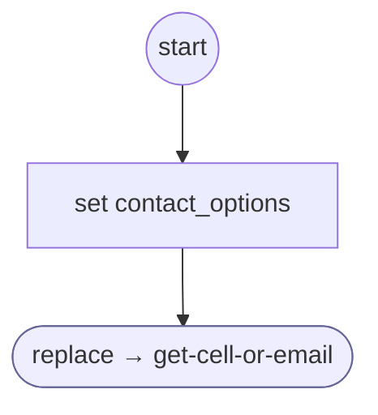

# ContactSplitFailed

<!-- generated:start -->
**ContactSplitFailed** · `contact-split-failed` · version 1.0.0 · worker (called by other flows) · steps · shared scope

> Restart a split identifier after too many digits.

- **Parameters:** 
  - `contact_options`: Current contact service options
- **Calls:** [get-cell-or-email](get-cell-or-email.md) (replace)
- **Tools:** none
- **Called by:** [get-cell-or-email](get-cell-or-email.md)

### Steps

<!-- generated:end -->
