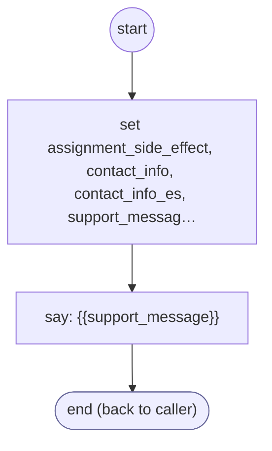

# ContactSupport

<!-- generated:start -->
**ContactSupport** · `contact-support` · version 1.2.3 · worker (called by other flows) · steps

> Worker: give the tenant's customer-service contact information. Params: support_context(_es), closing_prompt(_es).

- **Parameters:** 
  - `support_context`: What the caller needed help with (English), e.g. 'payment'
  - `support_context_es`: The same in Spanish, e.g. 'pago'
  - `closing_prompt`: Optional English sentence spoken after the contact info, e.g. a follow-up question
  - `closing_prompt_es`: Optional Spanish sentence spoken after the contact info
- **Calls:** no other flow
- **Tools:** none
- **Called by:** [authenticate-user](authenticate-user.md) (by name), [get-cell-or-email](get-cell-or-email.md) (value, by name), [validate-otp-code](validate-otp-code.md) (value, by name), [generic-retry-with-options](generic-retry-with-options.md) (value, by name), [ask-choice](ask-choice.md), [ask-email](ask-email.md), [shopify-ql-tracking-unavailable](../shopify/shopify-ql-tracking-unavailable.md) (shopify), [shopify-ql-track-order](../shopify/shopify-ql-track-order.md) (shopify) (cancel_flow of authenticate-user, cancel_flow), [shopify-ql-order-gate](../shopify/shopify-ql-order-gate.md) (shopify) (cancel_flow of authenticate-user, cancel_flow), [shopify-ql-order-desk](../shopify/shopify-ql-order-desk.md) (shopify), [shopify-ql-no-orders](../shopify/shopify-ql-no-orders.md) (shopify)

### Steps

<!-- generated:end -->
