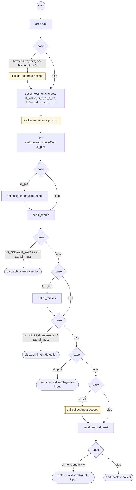

# DisambiguateInput

<!-- generated:start -->
**DisambiguateInput** · `disambiguate-input` · version 1.0.0 · worker (called by other flows) · steps · isolated scope

> Worker: the answer fits two or more inputs at the same scope (or a declared confirm_against pair). Stores the unambiguous readings, asks which input the rest was for (keys 1..n, never 8), stores the pick. No pick: nothing stored, not a miss. Params: readings, hits.

- **Parameters:** 
  - `readings`: The ambiguous readings
  - `hits`: Readings to store as they are
  - `remaining`: 
- **Calls:** [collect-input-accept](collect-input-accept.md) (call), [ask-choice](ask-choice.md) (call), [disambiguate-input](disambiguate-input.md) (replace)
- **Tools:** none
- **Called by:** [collect-input](collect-input.md), [collect-input-accept](collect-input-accept.md), [disambiguate-input](disambiguate-input.md), [confirm-form](confirm-form.md), [collect-service-answer](collect-service-answer.md)

### Steps

<!-- generated:end -->
