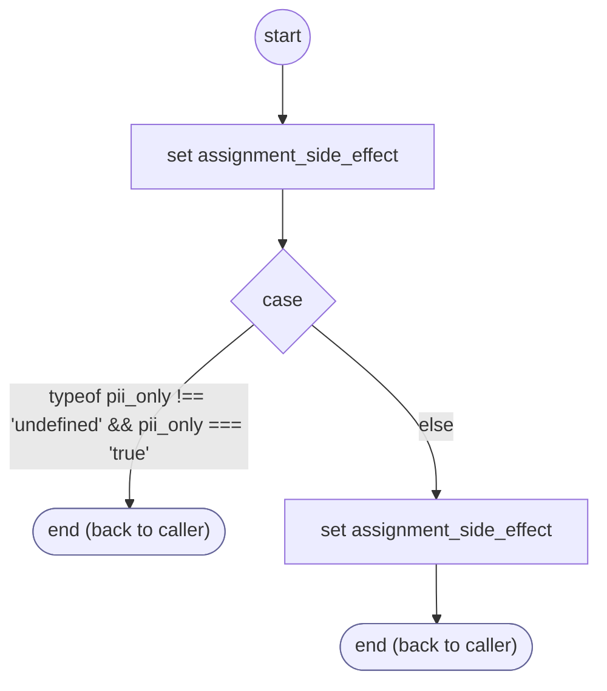

# FormDone

<!-- generated:start -->
**FormDone** · `form-done` · version 1.0.0 · worker (called by other flows) · steps · isolated scope

> Worker: a finished form hands its values to its parent's result input (a sub-form) and to cargo.formResults[form], without pii values unless keep_pii, then clears cargo.forms[form]. With pii_only, only the form's pii values are cleared. Params: form, keep_pii, pii_only.

- **Parameters:** 
  - `form`: The form id
  - `keep_pii`: Keep pii values in the result (the next step uses them)
  - `pii_only`: 'true': only clear the form's pii values (a declined confirmation); the form stays
- **Calls:** no other flow
- **Tools:** none
- **Called by:** [collect-phone](collect-phone.md), [collect-email](collect-email.md), [collect-zip](collect-zip.md), [collect-street-address](collect-street-address.md), [collect-city](collect-city.md), [collect-card-number](collect-card-number.md), [collect-card-expiration](collect-card-expiration.md), [collect-card-cvv](collect-card-cvv.md), [collect-card-zip](collect-card-zip.md), [collect-address](collect-address.md), [collect-credit-card](collect-credit-card.md), [collect-service-answer](collect-service-answer.md), [collect-geocoded-address](collect-geocoded-address.md), [confirm-input-proposal](confirm-input-proposal.md), [collect-contextual-answer](collect-contextual-answer.md), [shopify-ql-get-search-query](../shopify/shopify-ql-get-search-query.md) (shopify), [shopify-ql-product-dialog](../shopify/shopify-ql-product-dialog.md) (shopify), [shopify-ql-product-stores](../shopify/shopify-ql-product-stores.md) (shopify), [shopify-ql-product-variant](../shopify/shopify-ql-product-variant.md) (shopify), [shopify-ql-product-location-retry](../shopify/shopify-ql-product-location-retry.md) (shopify), [shopify-ql-product-links](../shopify/shopify-ql-product-links.md) (shopify), [shopify-ql-order-question](../shopify/shopify-ql-order-question.md) (shopify), [shopify-ql-tracking-inputs](../shopify/shopify-ql-tracking-inputs.md) (shopify), [shopify-ql-policy-question](../shopify/shopify-ql-policy-question.md) (shopify)

### Steps

<!-- generated:end -->
