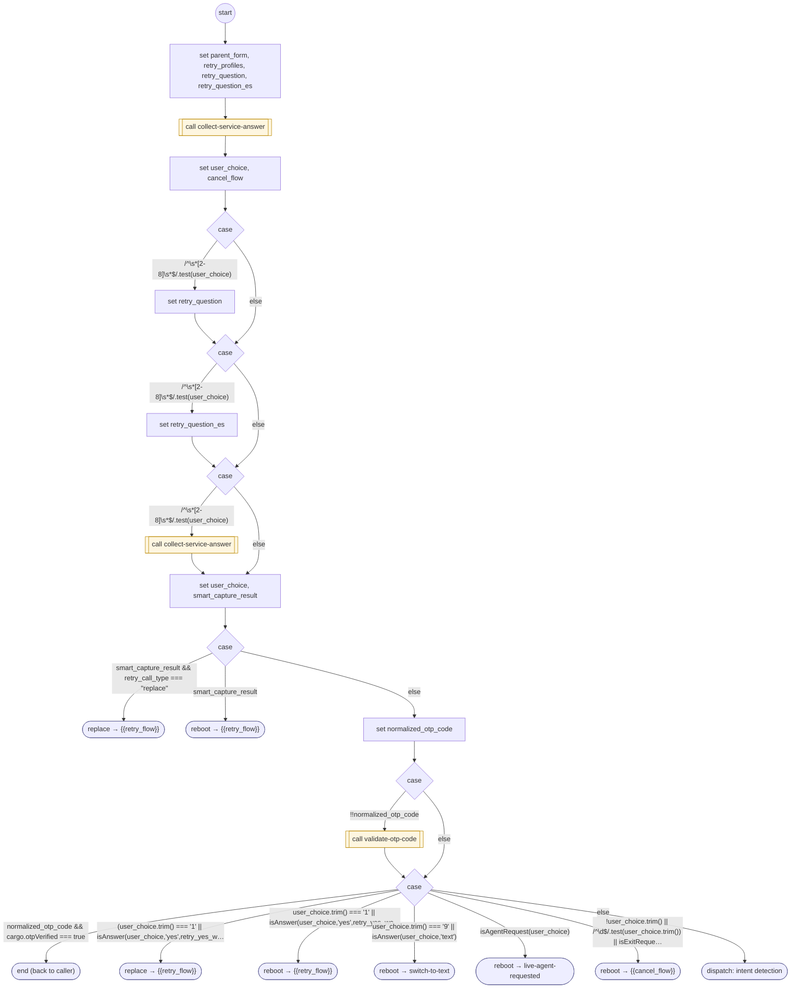

# GenericRetryWithOptions

<!-- generated:start -->
**GenericRetryWithOptions** · `generic-retry-with-options` · version 1.0.0 · worker (called by other flows) · steps · isolated scope

> Collect a retry, alternate contact, code or exit through the shared FORM adapter.

- **Parameters:** 
  - `error_message`: Failure sentence
  - `error_message_es`: Spanish failure sentence
  - `retry_flow`: Retry destination
  - `cancel_flow`: Exit destination
  - `capture_patterns`: Declared contact capture readers
  - `retry_call_type`: reboot or replace
  - `allow_code_entry`: Accept the active six-digit challenge
  - `question`: Retry question
  - `question_es`: Spanish retry question
  - `caller_outcome`: Unresolved outcome
  - `caller_reason`: Unresolved reason
  - `parent_form`: Owning task FORM instance
  - `contact_options`: Contact field protocol declaration
- **Calls:** [authenticate-user](authenticate-user.md) (value), [contact-support](contact-support.md) (value, by name), [collect-service-answer](collect-service-answer.md) (call), {{retry_flow}} (replace, reboot), [validate-otp-code](validate-otp-code.md) (call), [switch-to-text](switch-to-text.md) (reboot), [live-agent-requested](live-agent-requested.md) (reboot), {{cancel_flow}} (reboot)
- **Tools:** none
- **Called by:** [authenticate-user](authenticate-user.md), [get-cell-or-email](get-cell-or-email.md), [validate-otp-code](validate-otp-code.md), [otp-send-failed](otp-send-failed.md), [contact-not-on-file](contact-not-on-file.md)

### Steps

<!-- generated:end -->
