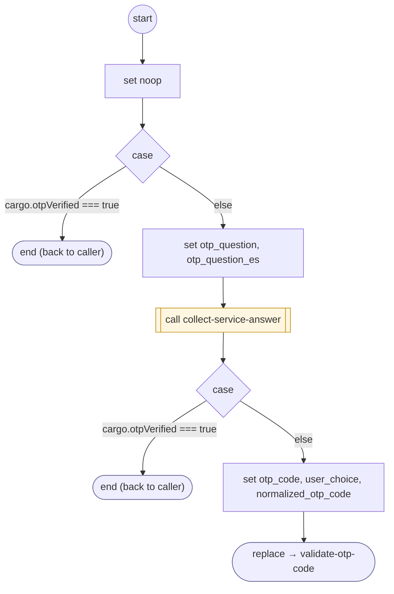

# GetAndValidateOtpCode

<!-- generated:start -->
**GetAndValidateOtpCode** · `get-and-validate-otp-code` · version 1.0.0 · worker (called by other flows) · steps · shared scope

> Collect a one-time-code answer through the owning FORM ancestry, preserving protocol commands for validation.

- **Parameters:** none
- **Calls:** [collect-service-answer](collect-service-answer.md) (call), [validate-otp-code](validate-otp-code.md) (replace)
- **Tools:** none
- **Called by:** [authenticate-user](authenticate-user.md), [validate-otp-code](validate-otp-code.md)

### Steps

<!-- generated:end -->
