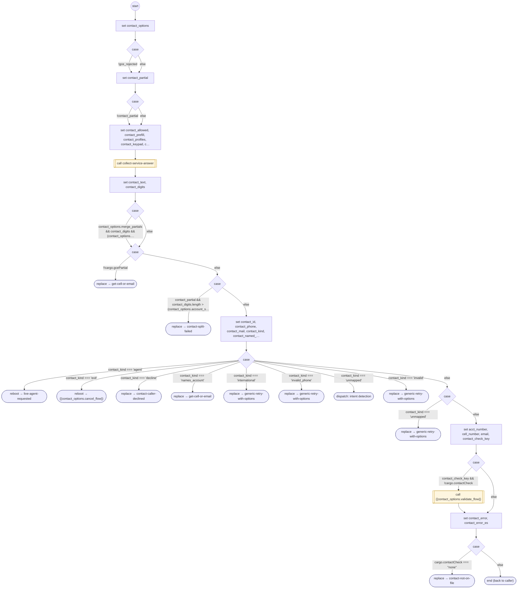

# GetCellOrEmail

<!-- generated:start -->
**GetCellOrEmail** · `get-cell-or-email` · version 1.0.0 · worker (called by other flows) · steps · shared scope

> Identify a supplied contact or account number; collect missing data through a FORM, with caller-ID eligibility and bounded contact validation.

- **Parameters:** 
  - `retry_flow`: Retry destination
  - `cancel_flow`: Exit destination
  - `cell_number`: Phone already supplied
  - `email`: Email already supplied
  - `acct_number`: Account identifier already supplied
  - `account_pattern`: Tenant account identifier pattern
  - `account_name`: English account identifier label
  - `account_name_es`: Spanish account identifier label
  - `account_shape`: Tenant keypad identifier shapes
  - `intro`: English introduction
  - `intro_es`: Spanish introduction
  - `caller_on_file`: yes, no or unknown caller-ID eligibility
  - `retry_call_type`: Retry destination invocation policy
  - `validate_flow`: Contact existence validator
  - `merge_partials`: Allow split account identifiers
  - `parent_form`: Owning task FORM instance
  - `contact_options`: Internal options across protocol transitions
  - `retrying`: Retry-menu continuation
  - `gce_partial`: Internal split identifier continuation
  - `gce_rejected`: Internal rejected contact continuation
- **Calls:** [authenticate-user](authenticate-user.md) (value, by name), [contact-support](contact-support.md) (value, by name), [collect-service-answer](collect-service-answer.md) (call), [get-cell-or-email](get-cell-or-email.md) (replace), [contact-split-failed](contact-split-failed.md) (replace), [live-agent-requested](live-agent-requested.md) (reboot), {{contact_options.cancel_flow}} (reboot), [contact-caller-declined](contact-caller-declined.md) (replace), [generic-retry-with-options](generic-retry-with-options.md) (replace), {{contact_options.validate_flow}} (call), [contact-not-on-file](contact-not-on-file.md) (replace)
- **Tools:** none
- **Called by:** [authenticate-user](authenticate-user.md), [get-cell-or-email](get-cell-or-email.md), [contact-caller-declined](contact-caller-declined.md), [contact-split-failed](contact-split-failed.md), [contact-not-on-file](contact-not-on-file.md)

### Steps

<!-- generated:end -->
