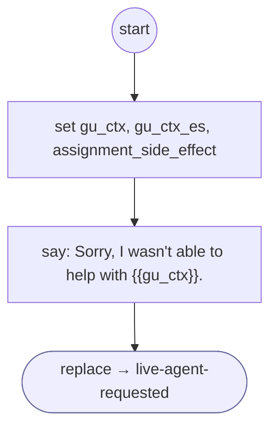

# GiveUp

<!-- generated:start -->
**GiveUp** · `give-up` · version 1.0.1 · worker (called by other flows) · steps

> Worker: a flow could not finish (tries ran out or a service failed); says so and hands off to live-agent-requested. Params: context / context_es ('your payment' / 'su pago').

- **Parameters:** 
  - `context`: What could not be finished (English), e.g. 'your payment'
  - `context_es`: The same in Spanish, e.g. 'su pago'
- **Calls:** [live-agent-requested](live-agent-requested.md) (replace)
- **Tools:** none
- **Called by:** [switch-to-text](switch-to-text.md), [collect-input](collect-input.md), [load-source](load-source.md), [confirm-form](confirm-form.md), [shopify-ql-product-links](../shopify/shopify-ql-product-links.md) (shopify), [shopify-ql-order-gate](../shopify/shopify-ql-order-gate.md) (shopify), [shopify-ql-orders-load](../shopify/shopify-ql-orders-load.md) (shopify), [shopify-ql-order-detail](../shopify/shopify-ql-order-detail.md) (shopify), [shopify-ql-order-detail-load](../shopify/shopify-ql-order-detail-load.md) (shopify), [shopify-ql-order-shipments](../shopify/shopify-ql-order-shipments.md) (shopify), [shopify-ql-order-desk](../shopify/shopify-ql-order-desk.md) (shopify), [shopify-ql-order-facts-load](../shopify/shopify-ql-order-facts-load.md) (shopify), [shopify-ql-tracking-load](../shopify/shopify-ql-tracking-load.md) (shopify), [shopify-ql-shipstation-track-by-number-verified](../shopify/shopify-ql-shipstation-track-by-number-verified.md) (shopify)

### Steps

<!-- generated:end -->
