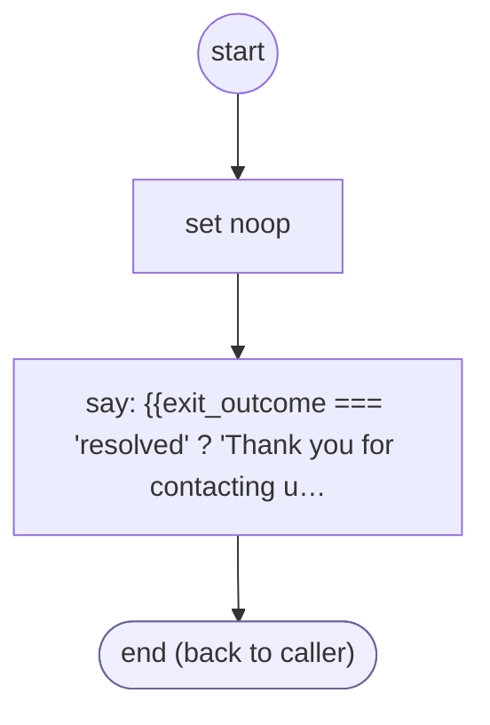

# GlobalExit

<!-- generated:start -->
**GlobalExit** · `global-exit` · version 1.1.0 · worker (called by other flows) · steps · isolated scope

> Worker (started by the engine): the caller exited; say the process was cancelled at their request (thanks when the outcome in force is resolved) and offer more help.

- **Parameters:** 
  - `exit_outcome`: The declared outcome in force when the caller exited (resolved: thanks)
  - `support_context`: What the caller needed help with (the question's exit_context), English; not spoken since 1.52.0
  - `support_context_es`: The same in Spanish
- **Calls:** no other flow
- **Tools:** none
- **Called by:** nothing (unreachable)

### Steps

<!-- generated:end -->
