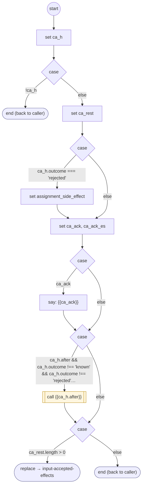

# InputAcceptedEffects

<!-- generated:start -->
**InputAcceptedEffects** · `input-accepted-effects` · version 2.0.0 · worker (called by other flows) · steps · isolated scope

> Worker: acknowledge accepted or rejected candidates and run their callbacks after the batch commit.

- **Parameters:** 
  - `readings`: 
- **Calls:** {{ca_h.after}} (call), [input-accepted-effects](input-accepted-effects.md) (replace)
- **Tools:** none
- **Called by:** [collect-input-accept](collect-input-accept.md), [input-accepted-effects](input-accepted-effects.md)

### Steps

<!-- generated:end -->
