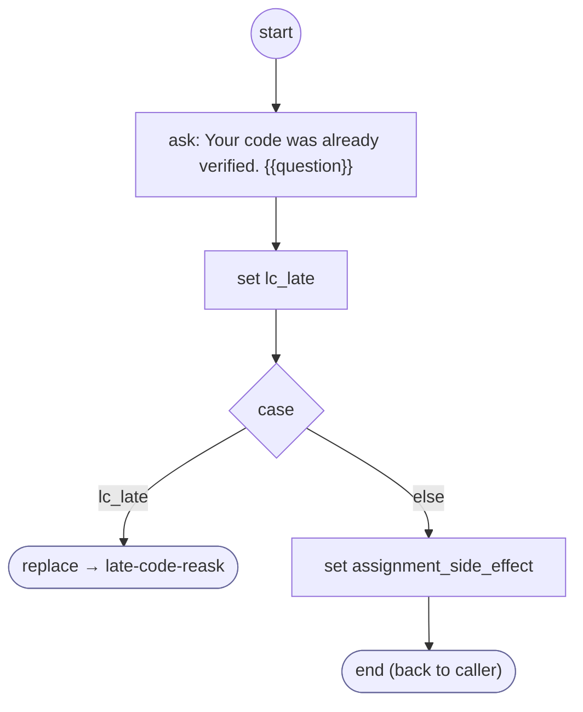

# LateCodeReask

<!-- generated:start -->
**LateCodeReask** · `late-code-reask` · version 1.0.0 · worker (called by other flows) · steps

> Worker (ask-choice, at the first question after a code was accepted): says the code was already verified and asks the question again, for as long as the answer is only digits found, in a row, in that code; leaves the first other answer in cargo.lateCodeAnswer.

- **Parameters:** 
  - `question`: 
  - `question_es`: 
  - `code`: 
- **Calls:** [late-code-reask](late-code-reask.md) (replace)
- **Tools:** none
- **Called by:** [ask-choice](ask-choice.md), [late-code-reask](late-code-reask.md)

### Steps

<!-- generated:end -->
