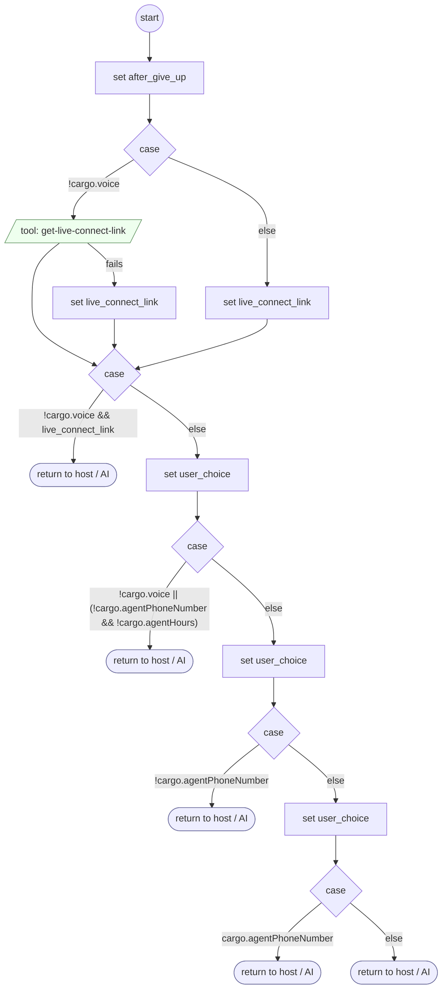

# LiveAgentRequested

<!-- generated:start -->
**LiveAgentRequested** · `live-agent-requested` · version 1.8.0 · **entry point** (intent detection can start it) · steps

> Customer wants to talk to a person, or says just 'agent' / 'AGENT': a live agent, a representative, customer service ('agent', 'speak to an agent', 'customer service representative', 'transfer me', 'I need to talk to someone', 'can I talk to a human', 'agente', 'representante', 'servicio al cliente', 'atención al cliente', 'transfiéreme', 'hablar con una persona', 'comunicarme con alguien', 'operator', 'manager', 'supervisor'), including a cut-off 'service' or 'al cliente' said alone. Not: continuing by text (SwitchToText); only asking for a phone number, email or hours (None). Transfers at once: no offer to continue with the assistant (the tenant's own interception covers it; owner 2026-10-28).

- **Parameters:** none
- **Calls:** no other flow
- **Tools:** `get-live-connect-link`
- **Called by:** intent detection, [get-cell-or-email](get-cell-or-email.md), [validate-otp-code](validate-otp-code.md), [generic-retry-with-options](generic-retry-with-options.md), [otp-text-undeliverable](otp-text-undeliverable.md), [give-up](give-up.md), [ask-choice](ask-choice.md), [ask-email](ask-email.md), [0](0.md), [read-form-reply](read-form-reply.md), [read-form-choice](read-form-choice.md), [read-confirm-reply](read-confirm-reply.md), [shopify-ql-order-desk](../shopify/shopify-ql-order-desk.md) (shopify)

### Steps

<!-- generated:end -->
