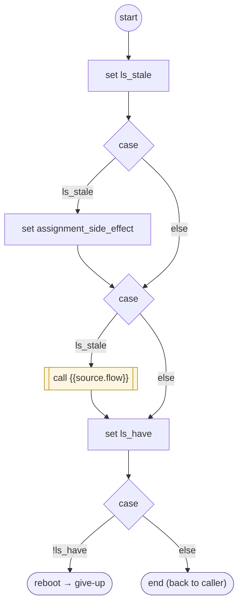

# LoadSource

<!-- generated:start -->
**LoadSource** · `load-source` · version 1.0.0 · worker (called by other flows) · steps · isolated scope

> Worker: load a provider's data when missing or stale (refresh: per_session | per_turn | max_age_ms) through the tenant's loader flow (source.flow), which writes source.result. Still missing after the loader: give-up (a service the caller needs failed). Param: source.

- **Parameters:** 
  - `source`: { flow, result, refresh, max_age_ms }
- **Calls:** {{source.flow}} (call), [give-up](give-up.md) (reboot)
- **Tools:** none
- **Called by:** [provide-data](provide-data.md), [shopify-ql-orders-fetch](../shopify/shopify-ql-orders-fetch.md) (shopify), [shopify-ql-order-detail](../shopify/shopify-ql-order-detail.md) (shopify), [shopify-ql-shipstation-track-by-number-verified](../shopify/shopify-ql-shipstation-track-by-number-verified.md) (shopify)

### Steps

<!-- generated:end -->
