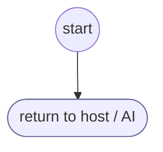

# NoActionNeeded

<!-- generated:start -->
**NoActionNeeded** · `no-action-needed` · version 1.0.0 · worker (called by other flows) · steps

> Handle case where no action is needed like when user is already authenticated

- **Parameters:** none
- **Calls:** no other flow
- **Tools:** none
- **Called by:** [shopify-ql-products-fetch](../shopify/shopify-ql-products-fetch.md) (shopify), [shopify-ql-store-policies](../shopify/shopify-ql-store-policies.md) (shopify), [shopify-ql-policies-load](../shopify/shopify-ql-policies-load.md) (shopify)

### Steps

<!-- generated:end -->
