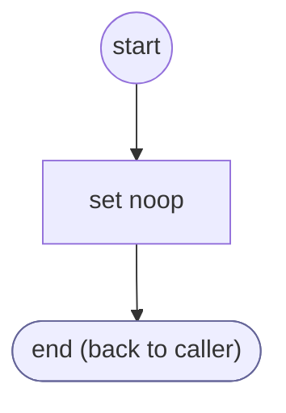

# OperationFailed

<!-- generated:start -->
**OperationFailed** · `operation-failed` · version 1.0.0 · worker (called by other flows) · steps · isolated scope

> Return an explicit transport failure to the invoking performer or provider.

- **Parameters:** 
  - `error`: Transport failure
- **Calls:** no other flow
- **Tools:** none
- **Called by:** [operation:shopify-search-products](../shopify/operation:shopify-search-products.md) (shopify), [operation:shopify-search-policies](../shopify/operation:shopify-search-policies.md) (shopify), [operation:shopify-store-availability](../shopify/operation:shopify-store-availability.md) (shopify), [operation:get-whatsapp-link](../shopify/operation:get-whatsapp-link.md) (shopify)

### Steps

<!-- generated:end -->
