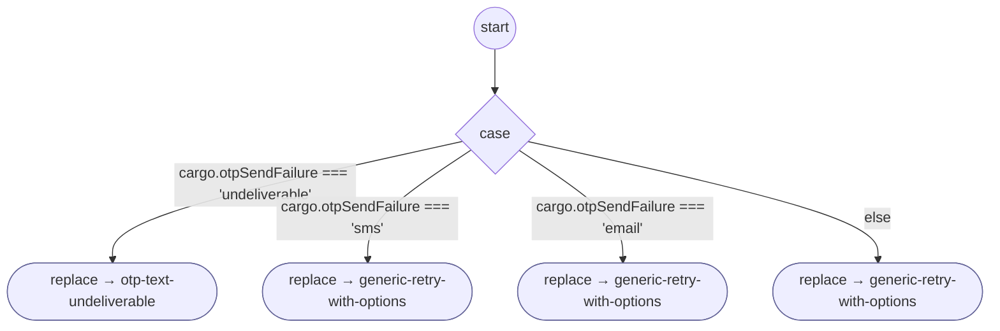

# OtpSendFailed

<!-- generated:start -->
**OtpSendFailed** · `otp-send-failed` · version 1.0.2 · worker (called by other flows) · steps

> Worker: a code could not be sent (cargo.otpSendFailure). A line that cannot receive texts goes to otp-text-undeliverable; any other failure offers the retry.

- **Parameters:** none
- **Calls:** [otp-text-undeliverable](otp-text-undeliverable.md) (replace), [generic-retry-with-options](generic-retry-with-options.md) (replace), [authenticate-user](authenticate-user.md) (retry_flow of generic-retry-with-options, retry_flow)
- **Tools:** none
- **Called by:** [authenticate-user](authenticate-user.md), [resend-otp-code](resend-otp-code.md)

### Steps

<!-- generated:end -->
