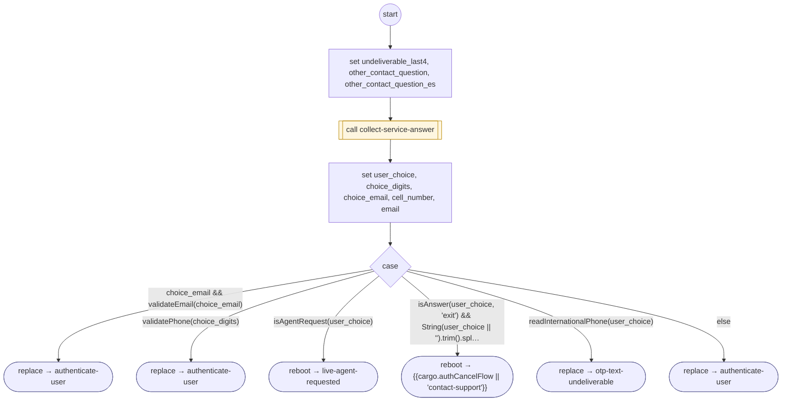

# OtpTextUndeliverable

<!-- generated:start -->
**OtpTextUndeliverable** · `otp-text-undeliverable` · version 1.1.0 · worker (called by other flows) · steps

> Worker for authenticate-user: the number cannot receive texts; ask for an email or a mobile number. The question is a form question (collect-service-answer): the answer is kept as spoken, so an email with digits in it is never reduced to its digits.

- **Parameters:** 
  - `note`: 'international' when asked again after a number outside the US and Canada: the question says codes reach only US and Canadian numbers
- **Calls:** [collect-service-answer](collect-service-answer.md) (call), [authenticate-user](authenticate-user.md) (replace), [live-agent-requested](live-agent-requested.md) (reboot), {{cargo.authCancelFlow || 'contact-support'}} (reboot), [otp-text-undeliverable](otp-text-undeliverable.md) (replace)
- **Tools:** none
- **Called by:** [otp-send-failed](otp-send-failed.md), [otp-text-undeliverable](otp-text-undeliverable.md)

### Steps

<!-- generated:end -->
