# PerformAction

<!-- generated:start -->
**PerformAction** · `perform-action` · version 1.0.0 · worker (called by other flows) · steps · isolated scope

> Worker: enforce form, gate and confirmation invariants; invoke a declared action once per prepared request and retain its explicit outcome.

- **Parameters:** 
  - `form`: 
  - `action`: 
  - `request`: 
  - `defer_receipt`: 
- **Calls:** {{action.gate.flow}} (call), {{action.flow}} (call)
- **Tools:** `jsfe:action-claim`, `jsfe:action-complete`
- **Called by:** [shopify-ql-product-links](../shopify/shopify-ql-product-links.md) (shopify)

### Steps

```mermaid
flowchart TD
   START(("start"))
   n0["set noop"]
   START --> n0
   c1{"case"}
   n0 --> c1
   b2[["call #123;#123;action.gate.flow#125;#125;"]]
   class b2 flowstep
   c1 -- "action.gate && action.gate.flow" --> b2
   n3["set pa_record, pa_run, pa_consult"]
   b2 --> n3
   c1 -- "else" --> n3
   c4{"case"}
   n3 --> c4
   b5[/"tool: jsfe:action-claim"/]
   class b5 toolstep
   c4 -- "pa_consult === true" --> b5
   b5f["set pa_claim"]
   b5 -- "fails" --> b5f
   c6{"case"}
   b5 --> c6
   b5f --> c6
   c4 -- "else" --> c6
   b7["set assignment_side_effect"]
   c6 -- "pa_claim && pa_claim.receipt && pa_claim.receipt.key" --> b7
   n8["set pa_execute"]
   b7 --> n8
   c6 -- "else" --> n8
   c9{"case"}
   n8 --> c9
   b10["set assignment_side_effect"]
   c9 -- "pa_execute === true" --> b10
   c11{"case"}
   b10 --> c11
   c9 -- "else" --> c11
   b12[["call #123;#123;action.flow#125;#125;"]]
   class b12 flowstep
   c11 -- "pa_execute === true" --> b12
   c13{"case"}
   b12 --> c13
   c11 -- "else" --> c13
   b14[/"tool: jsfe:action-complete"/]
   class b14 toolstep
   c13 -- "pa_execute === true" --> b14
   b14f["set pa_completion"]
   b14 -- "fails" --> b14f
   n15["set pa_result, assignment_side_effect"]
   b14 --> n15
   b14f --> n15
   c13 -- "else" --> n15
   DONE(["end (back to caller)"])
   class DONE endstep
   n15 --> DONE
   classDef endstep fill:#eef,stroke:#669
   classDef toolstep fill:#efe,stroke:#696
   classDef flowstep fill:#fef6e0,stroke:#b80
   classDef inputstep fill:#f3eefc,stroke:#75a
```

<!-- generated:end -->
