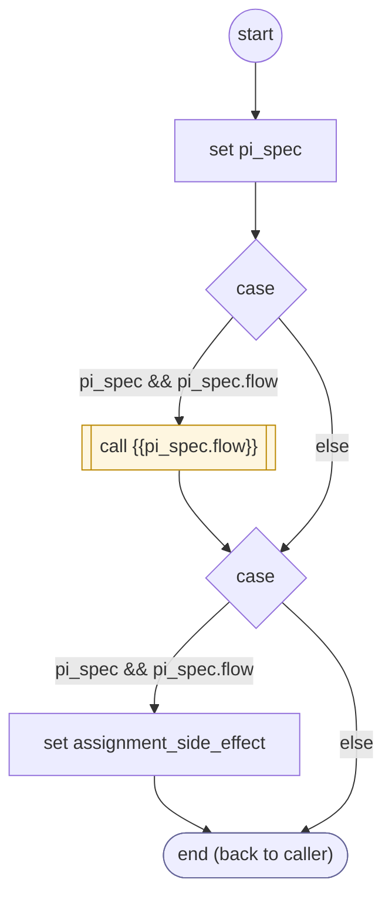

# PrepareInput

<!-- generated:start -->
**PrepareInput** · `prepare-input` · version 2.0.0 · worker (called by other flows) · steps · isolated scope

> Worker: run a field or group preparation once before prompting or validation, against committed prerequisites.

- **Parameters:** 
  - `form`: 
  - `input`: 
- **Calls:** {{pi_spec.flow}} (call)
- **Tools:** none
- **Called by:** [collect-input](collect-input.md), [validate-input-batch](validate-input-batch.md)

### Steps

<!-- generated:end -->
