# ProvideData

<!-- generated:start -->
**ProvideData** · `provide-data` · version 1.0.0 · worker (called by other flows) · steps · isolated scope

> Worker: answer a question about a provider catalog. Resolves `asked` (a fact or set key; empty = ask which), passes the catalog's gate for non-public facts (gate.flow, called with gate_params; then every path in gate.verified must be truthy), loads the source (load-source), says the facts (answer-facts). Params: provides, asked.

- **Parameters:** 
  - `form`: Originating FORM instance for task-owned deferred questions
  - `provides`: The provider catalog
  - `asked`: Fact or set key
  - `asked_keys`: Independent requested facts or sets
  - `no_menu`: 'true': answer only (a question asked inside a form)
  - `gate_params`: Identifiers the caller already gave, passed to the gate flow as gate_params
  - `no_gate`: 'true': the caller is inside a task on the verified account; the gate flow is not run (the verified paths are still checked)
- **Calls:** [ask-choice](ask-choice.md) (call), {{provides.gate.flow}} (call), [load-source](load-source.md) (call), [answer-facts](answer-facts.md) (call), [provide-queued-data](provide-queued-data.md) (call), [provider-menu](provider-menu.md) (call)
- **Tools:** none
- **Called by:** [collect-input](collect-input.md), [confirm-form](confirm-form.md), [provide-queued-data](provide-queued-data.md), [shopify-ql-product-search](../shopify/shopify-ql-product-search.md) (shopify), [shopify-ql-order-pickup](../shopify/shopify-ql-order-pickup.md) (shopify), [shopify-ql-order-track](../shopify/shopify-ql-order-track.md) (shopify), [shopify-ql-order-delivery](../shopify/shopify-ql-order-delivery.md) (shopify), [shopify-ql-order-items](../shopify/shopify-ql-order-items.md) (shopify), [shopify-ql-order-details](../shopify/shopify-ql-order-details.md) (shopify), [shopify-ql-store-policies](../shopify/shopify-ql-store-policies.md) (shopify)

### Steps

```mermaid
flowchart TD
   START(("start"))
   n0["set noop"]
   START --> n0
   c1{"case"}
   n0 --> c1
   b2(["end (back to caller)"])
   class b2 endstep
   c1 -- "!provides #124;#124; typeof provides !== 'object' #124;#124; !Array.isArray(provides.…" --> b2
   n3["set pd_keys, pd_menu, pd_mkeys, pd_menu_choices, pd_q, pd_q_es"]
   c1 -- "else" --> n3
   c4{"case"}
   n3 --> c4
   b5[["call ask-choice pd_q"]]
   class b5 flowstep
   c4 -- "!pd_keys.length" --> b5
   n6["set pd_keys"]
   b5 --> n6
   c4 -- "else" --> n6
   c7{"case"}
   n6 --> c7
   b8(["end (back to caller)"])
   class b8 endstep
   c7 -- "!pd_keys.length" --> b8
   n9["set pd_gated, pd_request"]
   c7 -- "else" --> n9
   c10{"case"}
   n9 --> c10
   b11(["end (back to caller)"])
   class b11 endstep
   c10 -- "pd_request.queued" --> b11
   c12{"case"}
   c10 -- "else" --> c12
   b13[["call #123;#123;provides.gate.flow#125;#125;"]]
   class b13 flowstep
   c12 -- "pd_gated && no_gate !== 'true'" --> b13
   n14["set pd_deferred, pd_keys, pd_ok"]
   b13 --> n14
   c12 -- "else" --> n14
   c15{"case"}
   n14 --> c15
   b16(["end (back to caller)"])
   class b16 endstep
   c15 -- "!pd_ok" --> b16
   c17{"case"}
   c15 -- "else" --> c17
   b18[["call load-source"]]
   class b18 flowstep
   c17 -- "provides.source && provides.source.flow" --> b18
   n19[["call answer-facts"]]
   class n19 flowstep
   b18 --> n19
   c17 -- "else" --> n19
   c20{"case"}
   n19 --> c20
   b21[["call provide-queued-data"]]
   class b21 flowstep
   c20 -- "pd_deferred.remaining.length #gt; 0" --> b21
   n22["set pd_ready"]
   b21 --> n22
   c20 -- "else" --> n22
   c23{"case"}
   n22 --> c23
   b24[["call provide-queued-data"]]
   class b24 flowstep
   c23 -- "pd_ready.length #gt; 0" --> b24
   n25["set pd_close, pd_who"]
   b24 --> n25
   c23 -- "else" --> n25
   c26{"case"}
   n25 --> c26
   b27["say: #123;#123;anythingElse('en', pd_who)#125;#125;"]
   c26 -- "pd_close" --> b27
   c28{"case"}
   b27 --> c28
   c26 -- "else" --> c28
   b29[["call provider-menu"]]
   class b29 flowstep
   c28 -- "provides.menu && no_menu !== 'true' && !pd_close" --> b29
   DONE(["end (back to caller)"])
   class DONE endstep
   b29 --> DONE
   c28 -- "else" --> DONE
   classDef endstep fill:#eef,stroke:#669
   classDef toolstep fill:#efe,stroke:#696
   classDef flowstep fill:#fef6e0,stroke:#b80
   classDef inputstep fill:#f3eefc,stroke:#75a
```

<!-- generated:end -->
