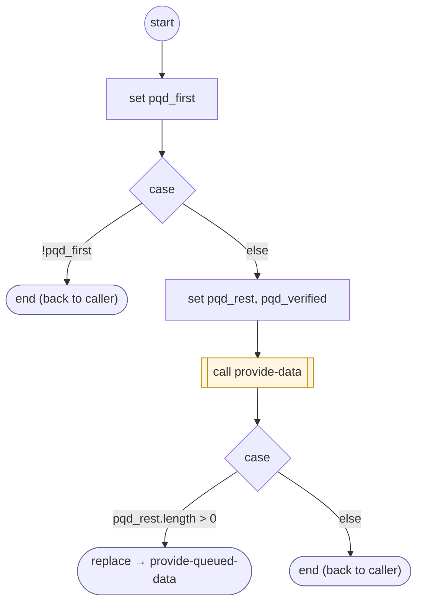

# ProvideQueuedData

<!-- generated:start -->
**ProvideQueuedData** · `provide-queued-data` · version 1.0.0 · worker (called by other flows) · steps · isolated scope

> Worker: answer the deduplicated private questions deferred during one owning task gate, checking each catalog before retrieval.

- **Parameters:** 
  - `form`: 
  - `requests`: 
- **Calls:** [provide-data](provide-data.md) (call), [provide-queued-data](provide-queued-data.md) (replace)
- **Tools:** none
- **Called by:** [run-form](run-form.md), [provide-data](provide-data.md), [provide-queued-data](provide-queued-data.md)

### Steps

<!-- generated:end -->
