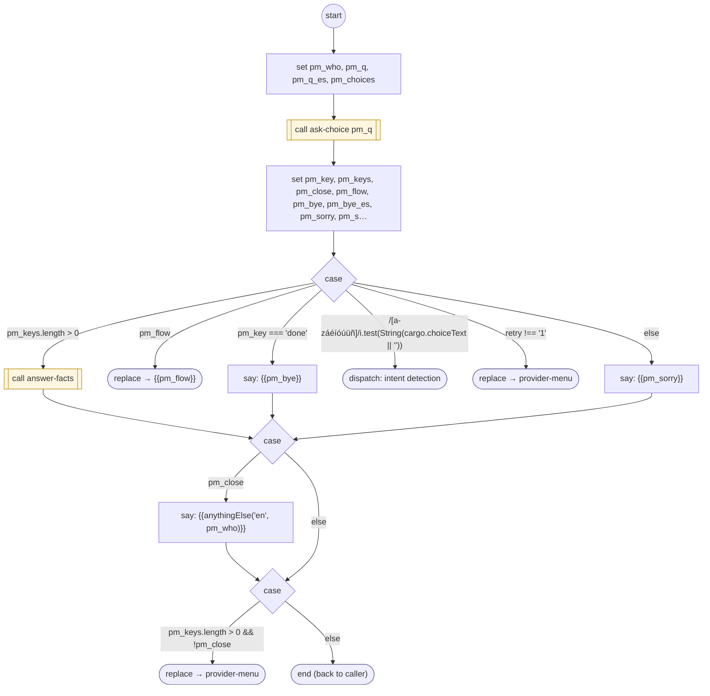

# ProviderMenu

<!-- generated:start -->
**ProviderMenu** · `provider-menu` · version 1.0.0 · worker (called by other flows) · steps · isolated scope

> Worker: after a provider answered, offer its menu (provides.menu: question(_voice)(_es) with {verb} / {name}; choices [{ key, phrases, flow, exact, set }]; done { phrases, say(_es) }). A fact or set named by its words is answered and the menu comes back; an action runs its flow (replace) after setting its `set` cargo fields; done says goodbye. Other phrases: DISPATCH. No phrases: asked once more, then 'anything else?'. Params: provides, retry.

- **Parameters:** 
  - `provides`: The provider catalog
  - `retry`: '1' on the re-ask
- **Calls:** [ask-choice](ask-choice.md) (call), [answer-facts](answer-facts.md) (call), {{pm_flow}} (replace), [provider-menu](provider-menu.md) (replace)
- **Tools:** none
- **Called by:** [provide-data](provide-data.md), [provider-menu](provider-menu.md)

### Steps

<!-- generated:end -->
