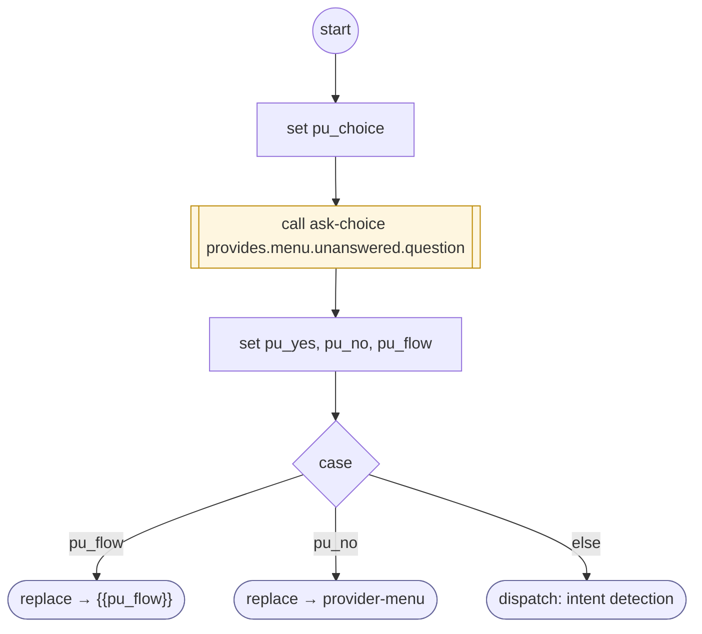

# ProviderUnanswered

<!-- generated:start -->
**ProviderUnanswered** · `provider-unanswered` · version 1.0.0 · worker (called by other flows) · steps · isolated scope

> Worker: a question the provider has no fact for, sent back to it from its own menu: says provides.menu.unanswered.question(_es) and offers that menu's choice unanswered.choice. YES runs it, NO returns to the menu, anything else is DISPATCHed. Param: provides.

- **Parameters:** 
  - `provides`: The provider catalog
- **Calls:** [ask-choice](ask-choice.md) (call), {{pu_flow}} (replace), [provider-menu](provider-menu.md) (replace)
- **Tools:** none
- **Called by:** [provide-data](provide-data.md)

### Steps

<!-- generated:end -->
