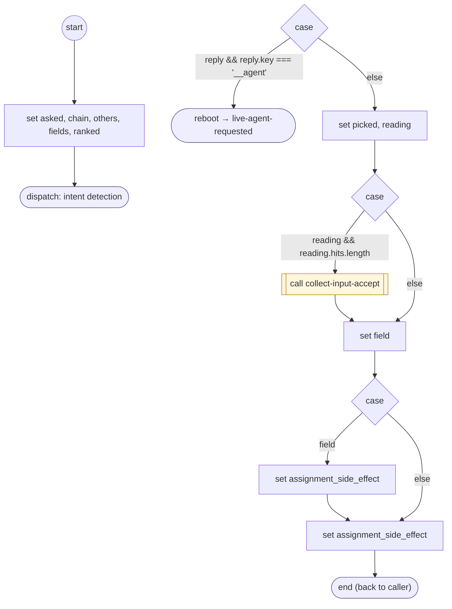

# ReadConfirmReply

<!-- generated:start -->
**ReadConfirmReply** · `read-confirm-reply` · version 1.3.0 · worker (called by other flows) · steps · isolated scope

> Rank an unreadable answer to a confirmation: it declines (NO), picks another of the form's choices (a correction, read as that input's answer), says a named field read back is wrong (confirm.named_fields: that input is asked again), asks for a person, or is asked again; a withdrawal or a new request leaves with saved form progress. Never confirms.

- **Parameters:** 
  - `form`: 
  - `question`: 
  - `question_es`: 
  - `named_fields`: 
- **Calls:** [live-agent-requested](live-agent-requested.md) (reboot), [collect-input-accept](collect-input-accept.md) (call)
- **Tools:** none
- **Called by:** [confirm-form](confirm-form.md)

### Steps

<!-- generated:end -->
