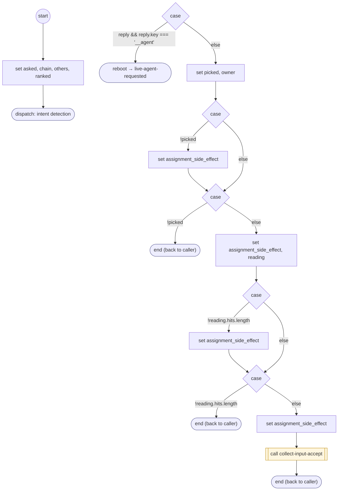

# ReadFormChoice

<!-- generated:start -->
**ReadFormChoice** · `read-form-choice` · version 1.3.0 · worker (called by other flows) · steps · isolated scope

> Rank an unreadable answer to a choice question and take the offered option it picks, or a request for a person or for text; otherwise ask again. A withdrawal or a new request leaves with saved form progress.

- **Parameters:** 
  - `form`: 
  - `input`: 
  - `question`: 
  - `question_es`: 
  - `choices`: 
  - `firm`: 
- **Calls:** [live-agent-requested](live-agent-requested.md) (reboot), [collect-input-accept](collect-input-accept.md) (call)
- **Tools:** none
- **Called by:** [collect-input](collect-input.md) (by name)

### Steps

<!-- generated:end -->
