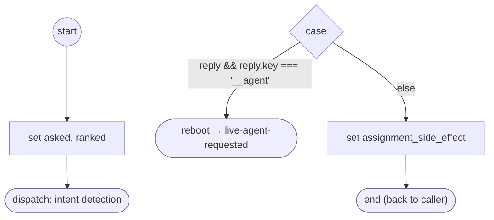

# ReadFormReply

<!-- generated:start -->
**ReadFormReply** · `read-form-reply` · version 1.1.0 · worker (called by other flows) · steps · isolated scope

> Rank an unreadable answer against its question: a request for a person or for text is taken; an answer is asked again; a withdrawal or a new request leaves with saved form progress.

- **Parameters:** 
  - `form`: 
  - `input`: 
  - `question`: 
  - `question_es`: 
- **Calls:** [live-agent-requested](live-agent-requested.md) (reboot)
- **Tools:** none
- **Called by:** [collect-input](collect-input.md) (by name)

### Steps

<!-- generated:end -->
