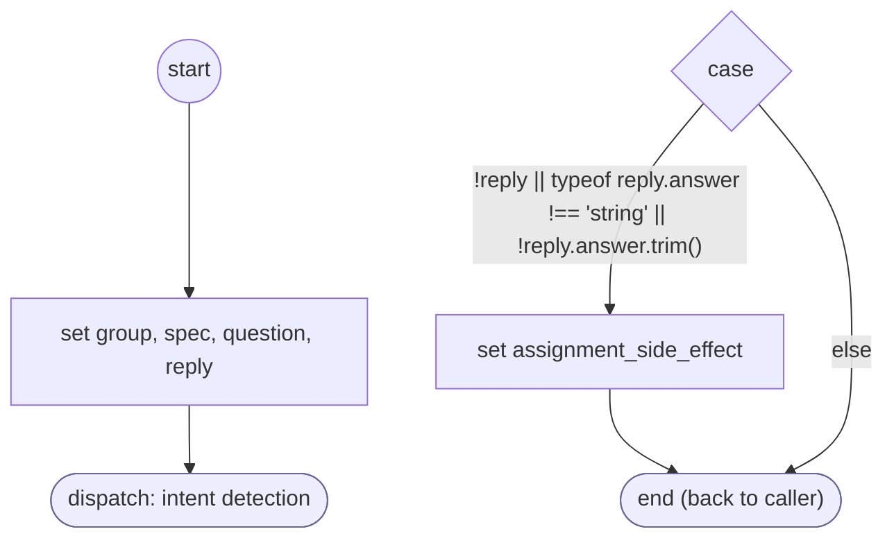

# ReadFormResponse

<!-- generated:start -->
**ReadFormResponse** · `read-form-response` · version 1.0.0 · worker (called by other flows) · steps · isolated scope

> Read the requested field with contextual DISPATCH: an answer continues, an answer with nothing usable is asked again, a withdrawal or a new request leaves with saved form progress.

- **Parameters:** 
  - `form`: 
  - `input`: 
- **Calls:** no other flow
- **Tools:** none
- **Called by:** [validate-input-batch](validate-input-batch.md)

### Steps

<!-- generated:end -->
